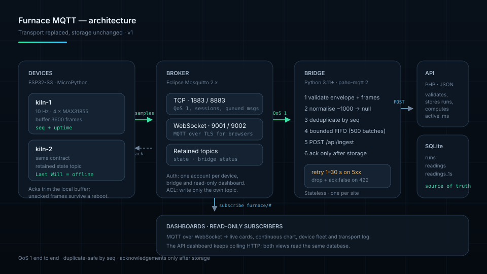

# Furnace MQTT stack

An alternative telemetry path for the furnace: the ESP32-S3 publishes each batch
to a broker instead of POSTing it, a bridge stores it through the existing PHP
API, and the dashboard subscribes for live data. History, CSV export and range
analysis are unchanged — MQTT replaces the transport, not the storage.



## Why MQTT

| Concern | HTTP uploader (existing) | MQTT path |
| --- | --- | --- |
| Connection | One TCP/TLS handshake per batch | One session, kept open |
| Delivery | Device retries a POST | Broker queues QoS 1, bridge acks after storage |
| Presence | Inferred from a timeout | Retained `state` topic + Last Will |
| Fan-out | One consumer | Any number of subscribers (dashboard, lab tools, alerts) |
| API outage | Device buffer only | Device buffer **and** bridge queue |

The HTTP path stays supported: `esp32-s3/` is untouched, and both paths write to
the same `POST /api/ingest`, so a site can migrate board by board.

## Folder map

| Path | What it is |
| --- | --- |
| [`bridge/`](bridge/README.md) | Python service: MQTT in, API batches out, acks back |
| [`firmware/`](firmware/README.md) | MicroPython transport with buffering and acks |
| [`broker/`](broker/README.md) | Mosquitto configuration and production hardening |
| [`dashboard/`](dashboard/README.md) | Static MQTT-over-WebSocket monitor and style guide |
| [`docs/`](docs/) | Architecture, protocol, operations, design system |
| [`docker-compose.yml`](docker-compose.yml) | Broker + bridge + dashboard for development |

## Quick start

```bash
cd MQTT

# 1. Broker and dashboard
docker compose up -d broker dashboard

# 2. Bridge (needs an API; see the note below)
docker compose up -d bridge

# 3. Publish a batch by hand
mosquitto_pub -h 127.0.0.1 -t furnace/lab/kiln-1/samples -q 1 \
  -m '{"v":1,"seq":1,"frames":[[0,[700,710,720,730],[0,0,0,0]]]}'

# 4. Watch it arrive
mosquitto_sub -h 127.0.0.1 -t 'furnace/#' -v
```

Open <http://localhost:8080> for the dashboard. `docker compose` expects a
running API; point `FURNACE_API_URL` at it, or start the bridge by hand with
`--dry-run` to test the broker and firmware without a database.

Run the existing backend locally:

```bash
cd backend && FURNACE_DB=var/furnace.sqlite php -S 127.0.0.1:8000 index.php
```

## Topics

| Topic | Direction | QoS | Retain | Purpose |
| --- | --- | --- | --- | --- |
| `furnace/<site>/<device>/samples` | device → broker → bridge | 1 | no | Frame batches |
| `furnace/<site>/<device>/ack` | bridge → device | 1 | no | Stored / rejected |
| `furnace/<site>/<device>/state` | device → broker | 1 | **yes** | Online flag, Last Will |
| `furnace/<site>/_bridge/status` | bridge → broker | 0 | **yes** | Queue, counters, errors |

`<site>` is a logical grouping (a building, a lab), `<device>` is one board
(`kiln-1`). Details and payload schemas: [`docs/protocol.md`](docs/protocol.md).

## Batch payload

```json
{
  "v": 1,
  "seq": 42,
  "at": 1730000000000,
  "frames": [
    [12000, [1024.6, 998.2, 1010.4, 1002.1], [0, 0, 0, 0]],
    [12100, [1024.7, null,   1010.5, 1002.2], [0, 1, 0, 0]]
  ]
}
```

* `seq` — per-device batch counter, used for deduplication.
* `at` — wall clock of the **newest** frame; earlier frames are placed by their
  uptime distance. Omitted before NTP sync, in which case the API anchors the
  batch on arrival.
* `t` — four temperatures; `null` for a faulted channel (the firmware's `-1000`
  sentinel is normalised away by the bridge).
* `f` — four MAX31855/MAX31865 fault codes, passed through for diagnosis.

## Reliability in one paragraph

The device keeps every frame until an `ack` for that batch arrives, and the
bridge only publishes an `ack` after the API has stored the rows. Between them,
the bridge holds a bounded FIFO (500 batches by default) and retries 5xx,
timeouts, auth and rate-limit failures with exponential backoff; validation
errors are acknowledged as failed instead of blocking the queue. A duplicate
`seq` is acknowledged without a second write, so QoS 1 duplicates are harmless.
A crash is visible because the bridge's Last Will flips the retained status
topic to `online: false`.

## Configuration summary

| Component | Configured by |
| --- | --- |
| Broker | [`broker/mosquitto.conf`](broker/mosquitto.conf), [`broker/acl.example`](broker/acl.example) |
| Bridge | `bridge/config.toml` or `FURNACE_MQTT_*` environment variables |
| Firmware | `MqttTransport(...)` arguments |
| Dashboard | [`dashboard/assets/config.js`](dashboard/assets/config.js) |

## Testing

```bash
python3 -m unittest discover -s MQTT/bridge/tests      # 33 tests
python3 -m unittest discover -s MQTT/firmware/tests    # 11 tests
node --check MQTT/dashboard/assets/js/app.js           # syntax only
```

The Python suites need no broker, no API and no third-party packages. The
dashboard is a static page; open it against a running broker to exercise it.

## Security

The development compose stack allows anonymous clients and binds to localhost.
For anything reachable from a network: passwords, per-device ACLs, TLS on 8883
and 9002, and a read-only dashboard account. The full checklist, including
certificate commands and Mosquitto limits, is in
[`broker/README.md`](broker/README.md) and
[`docs/operations.md`](docs/operations.md).

## Troubleshooting

| Symptom | Likely cause | Fix |
| --- | --- | --- |
| Dashboard says *Connecting* forever | WebSocket listener missing or wrong path | Check `listener 9001` + `protocol websockets`; try `ws://host:9001/mqtt` |
| `Not authorized` in the bridge log | Anonymous access disabled without credentials | Set `FURNACE_MQTT_USERNAME` / `_PASSWORD` |
| Status topic shows `queued` growing | API unreachable or rejecting writes | Check the bridge log, `FURNACE_MQTT_API_URL`, and the ingest key |
| `rejected` grows, no data stored | Firmware payload does not match protocol v1 | Run the bridge with `--dry-run --log-level DEBUG` |
| Cards say *held* but the chart is flat | That channel is faulted; the last good value is pinned | Check the thermocouple and the fault bits in the table |
| No frames in the dashboard, broker fine | Site mismatch | `config.site` must equal the second topic level |

## Documents

* [Architecture](docs/architecture.md) — components, flows, failure model, capacity
* [Protocol](docs/protocol.md) — topic grammar, payloads, validation, versioning
* [Operations](docs/operations.md) — deployment, TLS, monitoring, runbooks
* [Design system](docs/design-system.md) — tokens, components, accessibility
* [Living style guide](dashboard/styleguide.html)
