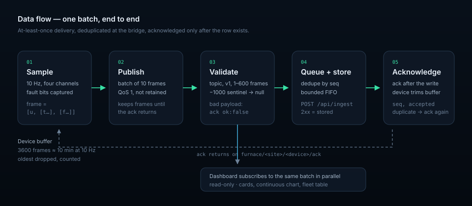
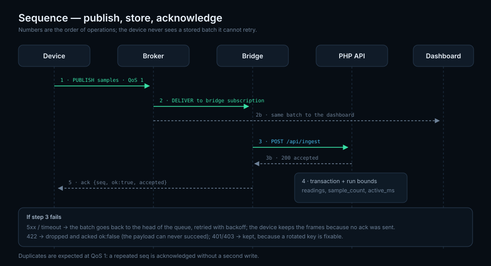

# Architecture

## Context

The furnace firmware samples four thermocouples at 10 Hz. Until now every batch
was POSTed to a PHP API that writes SQLite. That works, but a batch is a
connection: on a lossy Wi-Fi link the handshake costs more airtime than the
payload, and an API restart is invisible to the device until the next attempt.

MQTT moves the transport to a broker that is designed to hold connections and
queue messages. The API stays the only writer to the database; a bridge is the
single consumer that turns MQTT batches into `POST /api/ingest` calls.

## Components

| Component | Responsibility | Fails how |
| --- | --- | --- |
| **Device** (`firmware/`) | Sample, buffer, publish QoS 1, trim on ack, publish retained state | Loses buffer beyond 10 min; will flips state to offline |
| **Broker** (Mosquitto) | Authenticate, authorise, queue QoS 1, retain state/status, fan out | Clients reconnect with backoff; retained topics survive a restart |
| **Bridge** (`bridge/`) | Validate, deduplicate, queue, POST, ack, publish status | Bounded memory; retries; status shows queue depth and last error |
| **API** (existing PHP) | Validate, store, compute run aggregates | Bridge holds batches and retries |
| **Dashboard** (`dashboard/`) | Subscribe, render cards/chart/table | Read-only; a stale tab cannot corrupt anything |

The bridge is deliberately the only component with database-adjacent
credentials. Devices get write access to one topic each; browsers get read-only
access to the site's topics.

## Data flow

1. The firmware appends `[uptime_ms, [t…], [f…]]` to its buffer and publishes a
   batch of `batch_size` unsent frames with `seq = n`, QoS 1.
2. The broker stores the PUBLISH for the bridge subscription (QoS 1) and
   forwards it.
3. The bridge validates the topic, protocol version, frame shape and ranges,
   normalises the `-1000` fault sentinel to `null`, and rejects the batch if a
   duplicate `seq` is already stored.
4. The batch enters the bounded queue. A worker POSTs it to `/api/ingest`.
5. On 2xx the bridge publishes `{seq, ok:true, accepted}` to `/ack`.
6. The device drops the acknowledged frames; anything unacknowledged is
   republished on reconnect.
7. The dashboard receives the same `samples` message directly from the broker
   (it does not wait for the API), so the screen is never behind the bridge
   queue.

## Reliability model

**At-least-once, deduplicated end to end.**

* Broker → bridge is QoS 1, so duplicates are expected, not exceptional.
* The device `seq` is the dedupe key. The bridge remembers the last accepted
  `seq` per device in memory and acknowledges a repeat without a second write.
  A restarted bridge loses that memory, but the API's own `(run, t)` handling and
  the ordering of batches make a re-delivered batch a no-op in practice; the
  window is one in-flight batch, not a day of data.
* A `seq` that jumps backwards by more than 1000 is treated as a device reboot
  and accepted, so a fresh boot is never locked out.
* The queue is ordered. A failed batch is put back at the **front** so a later
  batch cannot overtake it.
* Acks are published **after** storage. An ack published on receipt would turn
  the path into at-most-once the moment the API fails.

## Failure model

| Failure | Effect | Recovery |
| --- | --- | --- |
| Wi-Fi drops on the device | Publish raises; client dropped, backoff 2–60 s, buffer grows | Reconnect publishes the oldest unsent frames; duplicates ignored |
| Device reboots | Retained state flips to offline via Last Will; `seq` restarts at 0 | Backwards-jump rule accepts it |
| Broker restarts | Sessions reconnect; retained state/status republished | QoS 1 messages in flight are retried by clients |
| Bridge crashes | Retained status goes `online:false`; devices keep buffering | Restart drains from the device buffers |
| API 5xx / timeout | Batch requeued with exponential backoff | Bridge catches up in order |
| API 422 | Batch dropped and acked `ok:false` | Firmware logs; fix the payload version |
| Queue full | Oldest batch dropped, `dropped` increments | Alert on the retained status |
| Dashboard closed | Nothing; it is read-only | Reopen and it rebuilds from live data |

## Time handling

Every frame carries device uptime (`u`, milliseconds). The batch carries `at`,
the wall clock of its newest frame, when NTP has synced. The bridge converts
`u` to absolute time by subtracting the distance from the newest frame, which
preserves the 0.1 s grid inside a batch.

Without `at` the API anchors the batch on arrival. That keeps data flowing
during commissioning, at the cost of a shifted timeline until NTP syncs; the
firmware publishes the retained `state` topic with its clock status so this is
visible.

## Capacity

* A 10 Hz furnace is ~100 bytes on the wire per batch of ten frames, ~10
  messages/s per device.
* Mosquitto handles tens of thousands of messages/s on one core; the bridge is
  the bottleneck because it is synchronous per batch.
* Each batch is one HTTP request. At 10 Hz that is one request per second per
  device; the API's ingest is a transaction, so the practical ceiling is a few
  dozen furnaces on one PHP worker pool.
* Bridge memory is `queue_limit × batch_size × ~200 bytes`; the default 500 ×
  600 frames is roughly 60 MB worst case, typically far less because batches are
  ten frames.

Scale plan if a site outgrows one bridge: one bridge per site (`FURNACE_MQTT_SITE`
is already scoped), sharing a broker and an API. The API is the only shared
writer, and each run belongs to one device.

## Decisions

**Why a bridge instead of writing MQTT straight into SQLite?**
The API already owns validation, run boundaries, `active_ms` and retention. A
second writer would duplicate all of it and drift.

**Why a separate ack topic instead of relying on QoS 1 PUBACK?**
A broker PUBACK only means the broker accepted the message, not that the data is
in the database. End-to-end acknowledgement is what makes the device buffer
useful.

**Why retained state and status?**
A dashboard that connects mid-outage should immediately know which devices are
offline and how deep the bridge queue is, without waiting for the next message.

**Why not let the browser query the API instead of MQTT?**
It can — the existing dashboard does. The MQTT dashboard is for low latency and
for fan-out (multiple screens, lab tools) without polling.

## Related documents

* [Protocol](protocol.md) — exact topics and payloads
* [Operations](operations.md) — deployment and runbooks
* [Design system](design-system.md) — the dashboard's visual contract
