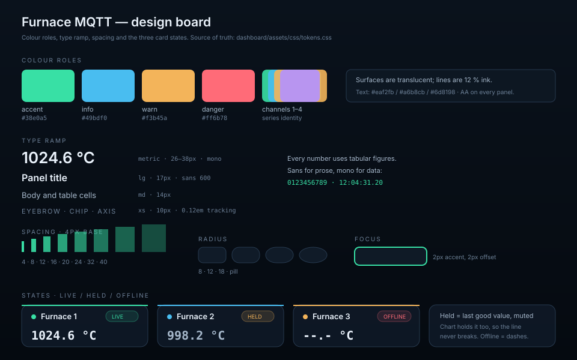

# Design system

The MQTT dashboard has one visual job: make a furnace's state readable in under a
second, on a phone in a hot room, without a legend lookup. The system is built
from tokens, a small component set and explicit state rules.

Live reference: [`../dashboard/styleguide.html`](../dashboard/styleguide.html).

## Principles

1. **Numbers before decoration.** Temperatures are monospaced, large and always
   in the same place. A glance should answer "what is it now".
2. **State is a colour, not a sentence.** `live`, `held` and `offline` are the
   only three states; each has one chip treatment and one value treatment.
3. **Never invent data.** A missing reading shows dashes, a held reading keeps
   its last known number and says *held*. The chart holds the value so the line
   stays continuous, but the card never pretends it is fresh.
4. **Calm surfaces.** Panels are translucent, borders are 1 px and low contrast,
   colour comes from the data. A screen full of alarms is unreadable.
5. **One accent.** Mint marks live/selected/primary. Amber is "attention, not
   broken", red is "broken or offline", blue is informational only.

## Tokens

All tokens live in [`dashboard/assets/css/tokens.css`](../dashboard/assets/css/tokens.css).
Components never use raw hex values.

### Colour roles

| Token | Role | Dark | Light |
| --- | --- | --- | --- |
| `--accent` | Live, primary action, focus | `#38e0a5` | `#0f9f70` |
| `--info` | Neutral information, cooling trend | `#49bdf0` | `#127cc0` |
| `--warn` | Held / delayed / attention | `#f3b45a` | `#a9660a` |
| `--danger` | Offline, rejected, dropped | `#ff6b78` | `#d62d44` |
| `--ch-1…4` | Series identity, shared by card, legend, chart | mint, cyan, amber, violet | darker equivalents |
| `--text-1` | Primary text | `#eaf2fb` | `#122033` |
| `--text-2` | Secondary text | `#a6b8cb` | `#42576c` |
| `--text-3` | Metadata, axis labels | `#6d8198` | `#6d8299` |
| `--surface-1/2` | Panels, raised tiles | translucent navy | translucent white |
| `--line`, `--line-strong` | Dividers, chip borders | 12 % / 22 % ink | 12 % / 20 % ink |

Channel colours are **not** semantic: they identify a series everywhere it
appears. Never recolour a card without recolouring its line and legend entry.

### Type

| Token | Size | Use |
| --- | --- | --- |
| `--text-2xl` | `clamp(24px, 2.4vw, 30px)` | Page title |
| `--text-xl` | `clamp(20px, 1.8vw, 24px)` | Section title |
| `--text-lg` | `17px` | Brand, card name |
| `--text-md` | `14px` | Body, table cells |
| `--text-sm` | `12px` | Secondary metadata, legend |
| `--text-xs` | `10px` | Eyebrows, chips, axis ticks |
| `--text-metric` | `clamp(26px, 3vw, 38px)` | Temperatures and counters |

Inter for prose; a monospaced stack (`--font-mono`) for **every** number, so
digits do not jitter as values change. Tabular numerals are enabled globally.

### Space, radius, elevation, motion

* 4 px base scale: `4, 8, 12, 16, 20, 24, 32, 40` (`--space-1…10`).
* Radii: `8` chips/inputs, `12` tiles, `18` panels, `999` pills.
* Elevation is two shadows only: `--shadow-panel` for surfaces,
  `--shadow-raised` for cards/tooltips. No drop shadow on text.
* Motion: `170ms` with `--ease`, used only for border/background changes.
  `prefers-reduced-motion` removes it.
* Focus: 2 px `--accent` ring, 2 px offset, never removed.

## Components

### Chip

Pill, uppercase 10 px, 7 px dot, 4/10 px padding. Variants:

| Class | Colour | Meaning |
| --- | --- | --- |
| `.chip--live` | accent, pulsing dot | connected / frame < 2.5 s |
| `.chip--delayed` | warn | held / reconnecting |
| `.chip--offline` | danger | offline / error |
| `.chip` (base) | neutral | labels, counts |

The pulse is 2.4 s and only on live. It is the single animation on the screen.

### Button and select

Pill, 8/14 px, 1 px `--line-strong`. Hover raises the border to the accent line.
`aria-pressed="true"` fills with `--accent-soft` and switches text to accent —
used by the legend toggles, so selection is visible without a second colour.

### Metric tile

Label (uppercase 10 px) → value (mono, `--text-metric`) → meta line. Used for
frame count, live rate, stored samples and loss counters. No icons: the label is
the icon.

### Furnace card

Channel colour as a 2 px top gradient and as the name dot. Value is the largest
thing in the card. Footer holds age; the `held` marker appears automatically via
`.is-held::after`.

| State | Value | Chip | Marker |
| --- | --- | --- | --- |
| live | `--text-1` | live | — |
| held | `--text-2` (muted) | held (warn) | `held` in the footer |
| offline | `--text-1` with `--.-` | offline (danger) | `no reading` |

### Chart

Canvas, 260–420 px tall, 48 px left gutter for the temperature axis and 14 px on
the right so the newest point is not clipped. Grid is `--line` at 1 px; labels
are 10 px mono in `--text-3`.

* Series are 2 px, round joins, no fill, no points except the newest.
* The last good value is carried across faulted frames, so a line is **never**
  broken. Continuity is a product requirement, not a default.
* The y-axis always covers at least 5 °C so a steady furnace does not look like
  a seismograph.
* Hover shows a vertical rule, a dot per series and a tooltip with the time and
  four values. The tooltip is `--surface-solid` with `--shadow-raised`.

### Table

Uppercase 10 px headers, 1 px bottom border, mono for device names, counts and
ages. Rows are clickable to select a device; hover is not required to read them.

### Log

Two-column list (time, topic + message), newest on top, capped at nine entries.
Errors use `--danger`; everything else `--text-2`. It is diagnostic, not a
timeline, so it never scrolls the page.

## Layout

* One column at ≤ 900 px; two balanced columns for devices/log above that.
* Max width 1440 px, 24–32 px page padding, 16–24 px gaps.
* Cards use `repeat(auto-fit, minmax(210px, 1fr))` so four fit on desktop and
  one per row on a phone without a media query.
* Nothing scrolls horizontally except the device table on very small screens.

## Accessibility

* Contrast: `--text-1` on `--surface-1` ≥ 12:1; `--text-3` on panels ≥ 4.5:1 in
  both themes. Chip text is ≥ 4.5:1 against its tinted background.
* Colour is never the only carrier: chips have text, held cards have a marker,
  offline cards have dashes.
* The canvas is `role="img"` with a label; every value is also in a card or the
  legend.
* Focus order follows the DOM: theme → device → legend → table rows.
* Hit targets are ≥ 32 px (buttons 36 px, legend pills 30 px with padding).
* Reduced motion disables the pulse and all transitions.

## Do / Don't

| Do | Don't |
| --- | --- |
| Use `--ch-n` for a series everywhere | Give a channel a different colour in the card and the chart |
| Show `--.-` when nothing was ever received | Show `0.0` for a missing reading |
| Leave a held value visible with its marker | Blank the card or draw a gap in the line |
| Use `--space-*` steps | Hand-tune 13 px gaps |
| Keep one accent for actions | Use mint for a warning |
| Test both themes | Design only for dark |
