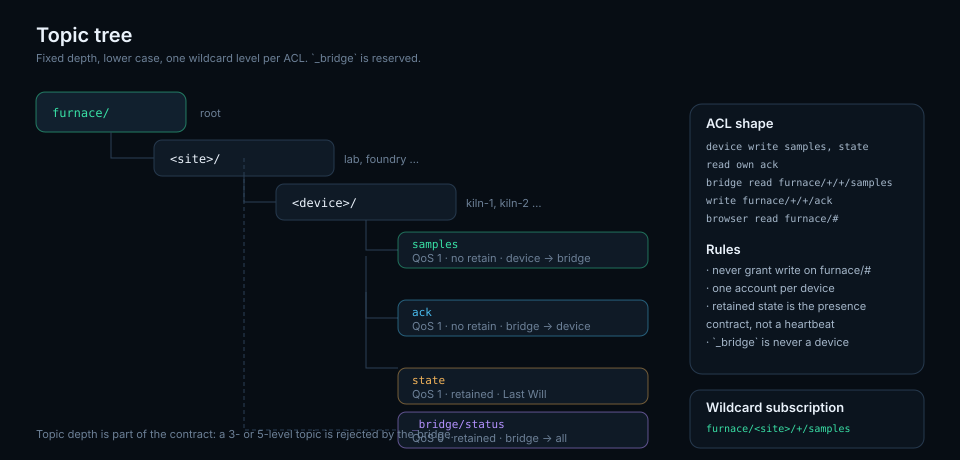

# Protocol v1

Everything on the wire is UTF-8 JSON in a single MQTT message. Topics are
lower-case, slash-separated and fixed-depth so ACLs can be written with
wildcards.



## Topic grammar

```
furnace/<site>/<device>/samples     device   → bridge     QoS 1, no retain
furnace/<site>/<device>/ack         bridge   → device     QoS 1, no retain
furnace/<site>/<device>/state       device   → everyone   QoS 1, retain
furnace/<site>/_bridge/status       bridge   → everyone   QoS 0, retain
```

* `<site>` — `[a-z0-9-]+`, one per installation (`lab`, `foundry`).
* `<device>` — `[a-z0-9-]+`, one per board (`kiln-1`).
* The bridge only accepts its configured site; a wildcard subscription may
  therefore be shared safely between sites.
* `_bridge` is reserved: it is never a device name. The bridge ignores sample
  topics for it.

## Message types

### `samples` (device → bridge)

```json
{
  "v": 1,
  "seq": 42,
  "at": 1730000000000,
  "frames": [
    [12000, [1024.6, 998.2, 1010.4, 1002.1], [0, 0, 0, 0]],
    [12100, [1024.7, null,   1010.5, 1002.2], [0, 1, 0, 0]]
  ]
}
```

| Field | Type | Rules |
| --- | --- | --- |
| `v` | int | Must be `1`; anything else is rejected |
| `seq` | int | `>= 0`, monotonically increasing per device |
| `at` | int | Optional. Unix ms of the **newest** frame in the batch |
| `frames` | array | 1–600 entries; the API's own batch ceiling is 600 |
| `frames[i][0]` | int | Device uptime in ms; within 120 s of the previous frame |
| `frames[i][1]` | array | Exactly four numbers or `null` |
| `frames[i][2]` | array | Exactly four integers, `0–255` |

`null` in `temps` means "no reading for that channel", and is what the dashboard
draws as a *held* value. The firmware's `-1000` sentinel and any value outside
`-999…1400 °C` are normalised to `null` by the bridge before the API sees them.

The bridge rejects a whole batch (and acks `ok:false`) if the envelope, frame
count or fault codes are malformed. It repairs temperatures instead of rejecting
the batch, because one broken thermocouple must not cost the other three
channels their data.

### `ack` (bridge → device)

```json
{"v": 1, "seq": 42, "ok": true, "accepted": 10, "error": null}
```

* `ok:true` — the API stored the batch. `accepted` is how many frames were
  stored; the device drops that many from the head of its buffer.
* `ok:false` — the API refused the payload; `error` is a short reason. The
  device keeps the frames for inspection/retry but must not spin: the bridge
  only sends `ok:false` for permanent validation failures.
* Duplicate deliveries of an already-stored `seq` are acknowledged with
  `ok:true` and the original `accepted` count, without a second write.

### `state` (device → broker, retained)

```json
{
  "v": 1,
  "online": true,
  "device": "kiln-1",
  "buffered": 0,
  "published": 48120
}
```

Published once on connect with `retain: true`, and registered as the Last Will
with `online: false` and `retain: true`. The broker therefore publishes the
offline version when the keepalive expires, even if the board lost power. The
dashboard treats `online:false` as authoritative over sample age.

### `_bridge/status` (bridge → broker, retained)

```json
{
  "online": true,
  "queued": 0,
  "received": 4821,
  "forwarded": 4820,
  "samples": 48120,
  "duplicates": 1,
  "rejected": 0,
  "dropped": 0,
  "failures": 0,
  "last_error": null,
  "uptime_s": 3600.2
}
```

Refreshed every `status_interval` seconds (default 15) and on shutdown. The
retained copy is the bridge's Last Will with `online:false`, so "bridge down" is
one subscribe away.

## Ordering and duplicates

MQTT guarantees ordering only per topic and per QoS. The pipeline relies on
that:

* One device publishes to exactly one `samples` topic, in order.
* The bridge handles messages on a single client and queues them in arrival
  order; a failed batch is requeued at the head.
* `seq` is the dedupe key. The bridge keeps the last accepted `seq` per device
  and drops `last-1000 < seq <= last`.
* A jump backwards beyond 1000 is a reboot and is accepted.

## Time semantics

| Clock | Source | Used for |
| --- | --- | --- |
| `u`, uptime | Device `time.ticks_ms()`/`millis()` | Placing frames inside a batch |
| `at`, wall clock | Device after NTP sync | Absolute timeline in the database |
| `received_at_ms` | API | Sample age, gap-aware idle time |

`at` refers to the newest frame, not the first: the batch is published when it
is full, so the publish instant is the end of the window. The bridge computes
`sample.at = at - (newestUptime - frameUptime)`.

## Versioning

* `v` is per message, not per connection. A device may keep publishing v1 while
  the bridge learns v2.
* Additive fields are allowed without a version bump; consumers must ignore
  unknown keys.
* A removed or re-typed field is v2. The bridge refuses unknown versions with a
  clear error and the payload is visible in `rejected`, so a failed rollout is
  obvious rather than silent.

## Examples

```bash
# Publish one batch
mosquitto_pub -h 127.0.0.1 -t furnace/lab/kiln-1/samples -q 1 \
  -m '{"v":1,"seq":1,"at":1730000000000,"frames":[[0,[700,710,720,730],[0,0,0,0]]]}'

# Watch acks
mosquitto_sub -h 127.0.0.1 -t 'furnace/lab/kiln-1/ack' -v

# Watch retained health
mosquitto_sub -h 127.0.0.1 -t 'furnace/lab/_bridge/status' -v -C 1

# Reject a bad version (bridge acks ok:false, API never sees it)
mosquitto_pub -h 127.0.0.1 -t furnace/lab/kiln-1/samples -q 1 \
  -m '{"v":9,"seq":2,"frames":[[0,[1,2,3,4],[0,0,0,0]]]}'
```

## HTTP mapping

The bridge converts a batch into the existing API contract:

```json
{"samples": [{"u": 12000, "t": [1024.6, null, 1010.4, 1002.1],
              "f": [0, 1, 0, 0], "at": 1729999999000}]}
```

`u` is kept because the API uses it for the 0.1 s grid and for the gap-capped
`active_ms`; `at` is forwarded when known. Nothing else about the storage model
changes, which is why history, export and analysis needed no work.
