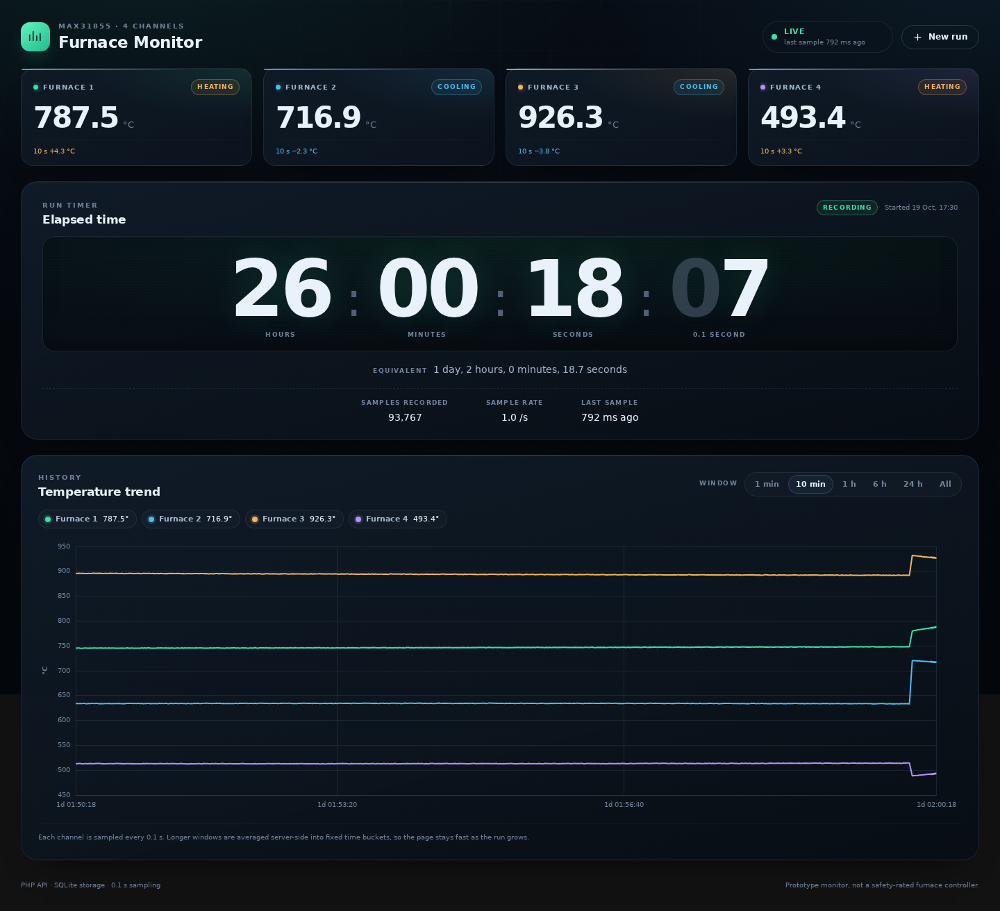
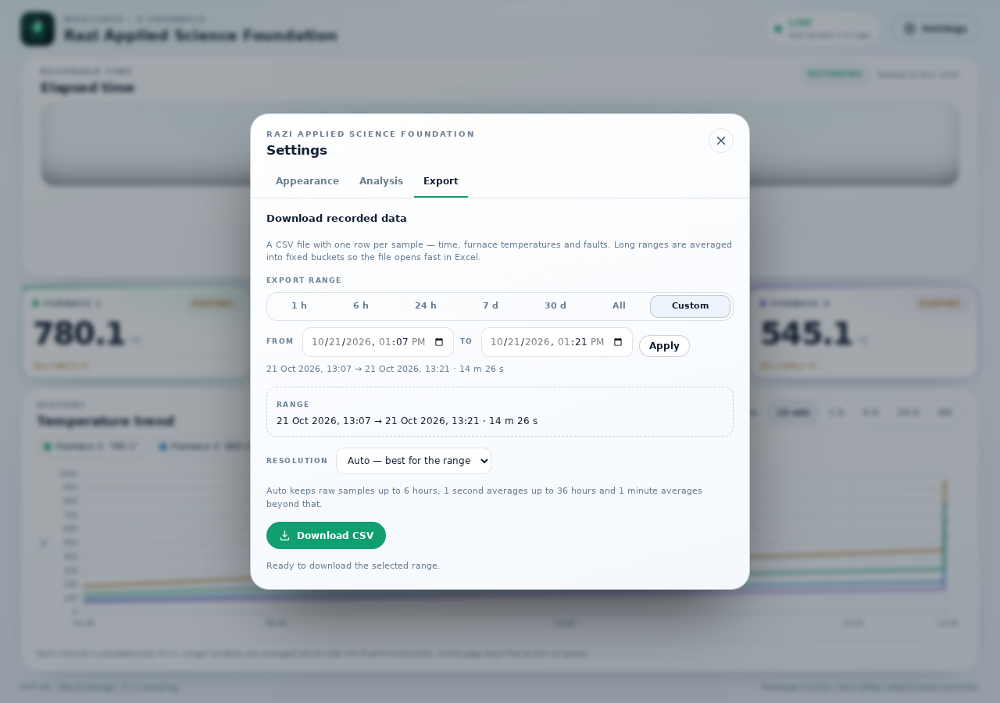
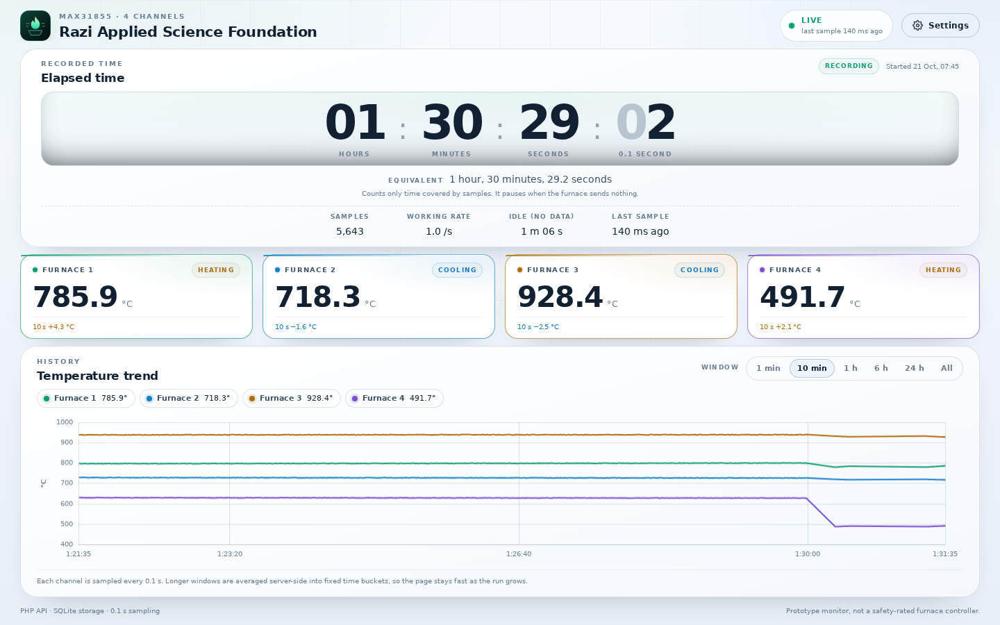
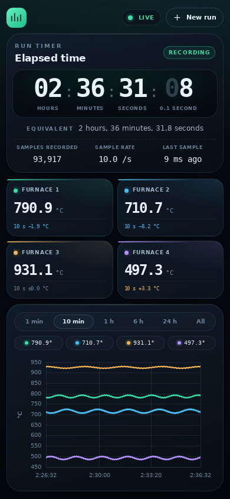

# Furnace Monitor

Four-channel furnace temperature monitoring with a Raspberry Pi Pico, four
MAX31855 thermocouple amplifiers, a PHP + SQLite API and a browser dashboard.

The **UI and the API run on separate servers**:

| Service | Production URL |
| ------- | -------------- |
| Dashboard (static files) | <https://temp.futurefounderco.com> |
| API (PHP + SQLite) | <https://apitemp.futurefounderco.com> |

The browser calls the API cross-origin; the API allows only the origins listed
in `FURNACE_ALLOWED_ORIGINS` (defaults to the dashboard above, over both http
and https — a browser treats those as two different origins).

The dashboard and the API must be reached over the **same scheme**:
`ui/config.js` copies `window.location.protocol`, so an `https://` page calls
`https://apitemp…` and an `http://` page calls `http://apitemp…`. A page loaded
over HTTPS cannot call an HTTP API (mixed content), and an HTTPS API without a
matching certificate cannot be reached at all.



The dashboard is branded for the **Razi Applied Science Foundation** and ships
with a light and a dark theme, min/max/average analysis with the time of each
extreme, CSV export with its own date picker, and an installable PWA manifest.






## What it does

- Samples four K-type thermocouples every **0.1 s** (10 Hz). The Pico prints
  each sample on USB serial; the PC collector stores them in a file and
  uploads that file to the API in batches.
- Stores every sample in SQLite through a small JSON API. No framework, no
  external database server.
- Puts the **eight-digit recorded-time timer** `HH:MM:SS:CC` at the top of the
  screen (hundredths of a second on the right, counting `00` to `99`) plus a
  human-readable equivalent below it.
- The timer follows **time covered by samples**, not the wall clock. It pauses
  while the furnace sends nothing, never jumps forward when data resumes, and
  keeps counting past 24 and 99 hours. A separate *Idle* stat shows the time
  the run was open without data.
- Shows the four temperatures as colour-coded cards under the timer and as four
  live lines on the chart beneath them. Each card is outlined in its chart
  colour.
- A **Settings** button opens a dialog with theme switching, per-furnace range
  analysis (coldest, hottest, average, min/max per furnace), CSV export with
  presets or custom date pickers, and the app-install action.
- Fits one screen at every size: the page never scrolls, the chart absorbs the
  height that is left over and the cards reflow from four columns to two.
- Long windows are averaged inside SQLite into fixed time buckets, so the chart
  stays responsive even after days of 10 Hz data.
- The dashboard is an installable **PWA**: add it to a phone home screen and it
  opens full screen, with the shell still available offline.

## Architecture

```
┌──────────────────────────────┐       HTTPS + CORS        ┌──────────────────────────────┐
│ temp.futurefounderco.com     │  GET /api/live, /history  │ apitemp.futurefounderco.com  │
│ static dashboard (ui/)       │  GET /api/summary, /export │ PHP API + SQLite (backend/)  │
│ + service worker + manifest  │  POST /api/runs/reset     │                              │
└──────────────▲───────────────┘ ────────────────────────▶ └──────────────▲───────────────┘
               │                                                          │ POST /api/ingest
        ┌──────┴──────┐                                            ┌──────┴───────────────┐
        │ Operator    │                                            │ collector/ on a PC   │
        └─────────────┘                                            │ file → HTTP batches  │
                                                                   └──────▲───────────────┘
                                                                          │ USB serial
                                                                   ┌──────┴───────────────┐
                                                                   │ Plain Pico + 4x      │
                                                                   │ MAX31855, 10 Hz      │
                                                                   └──────────────────────┘
```

| Folder      | Contents                                                        |
| ----------- | --------------------------------------------------------------- |
| `backend/`  | PHP API only: JSON endpoints, SQLite schema, CLI tools, tests    |
| `ui/`       | Static dashboard: HTML, design tokens, CSS, ES modules, config   |
| `module/`   | Pico firmware: serial + flash log at 10 Hz, no network, simulator |
| `collector/`| PC console app: serial/file capture, checkpointed upload to API   |
| `serial-web/`| Browser dashboard reading the COM port directly (Web Serial)     |
| `tests/`    | Node unit tests for the timer and formatting helpers             |
| `artifacts/`| Dashboard, settings and serial screenshots                      |

## Quick start (no hardware)

Requirements:

- PHP **8.1 or newer** with `pdo_sqlite` (and `json`, which is built in).
- Python 3.9+ for the static UI server, the simulator and the collector
  (`pyserial` is only needed for live serial capture).

```bash
# 1. create the database
php backend/bin/install.php

# 2. API server
php -S 0.0.0.0:8080 -t backend backend/index.php

# 3. UI server (second terminal), then open http://localhost:3000
python3 -m http.server 3000 --directory ui

# 4. fake furnace data (third terminal)
python3 module/simulator.py
```

Without any server at all, [`serial-web/`](serial-web/README.md) shows the four
temperatures in the same dashboard straight from the COM port.

With real hardware, step 4 is replaced by the collector, which reads the Pico
over USB serial and uploads from a file on the PC:

```bash
python -m pip install -r collector/requirements.txt
python collector/collector.py
```

Both scripts take no arguments; their settings are constants at the top of the
file. See [`collector/README.md`](collector/README.md).

The simulator takes no arguments: its `API_URL` (default
`http://127.0.0.1:8080`), `API_KEY` and intervals are constants at the top of
`module/simulator.py`.

The local UI automatically calls `http://localhost:8080` (see `ui/config.js`).
No CORS environment variable is needed locally: the API already allows
`http://localhost:3000` and `http://127.0.0.1:3000`.

### Demo history (optional)

```bash
FURNACE_DB=backend/var/demo.sqlite php backend/bin/seed_demo.php --hours=1
FURNACE_DB=backend/var/demo.sqlite php -S 0.0.0.0:8080 -t backend backend/index.php
```

The demo is generated at the real 10 Hz cadence, so the seeded run ends at the
moment of seeding with a timer near `01:00:00:0`, and the "All" window shows
the whole firing curve.

## Hardware

- Raspberry Pi Pico — a plain board is enough, no WiFi needed.
- 4x MAX31855 breakout boards with K-type thermocouples.
- A PC connected to the Pico by USB, running `collector/`.
- Shared SPI bus, one chip-select pin per amplifier.

Wiring, firmware upload and calibration are documented in
[`module/README.md`](module/README.md).

## Timer behaviour



- `HH:MM:SS:CC` — hours, minutes, seconds and hundredths of a second.
- The last two digits are a real 0–99 counter: they count `00` … `99` and then
  carry into the seconds field, so the display always has eight digit
  positions, exactly like `00:00:00:00`.
- Hours are not masked: the field grows from `99` to `100` and beyond.
- The value is the run's sample count: **one stored sample is 0.1 s**, so ten
  samples are one second and 8 620 samples read `00:14:22:00`. The count comes
  from the server, so it is exact even while the collector uploads in batches.
  Between two batches the hundredths run on for the part of the batch interval
  that has already passed, which is what makes them move at all. It is not a
  wall-clock counter: a Pico that stops sending settles the counter on the
  stored count after at most one batch interval and then freezes instead of
  inventing time, and it resumes from the same value when samples come back.
- Refreshing the page, rebooting the Pico, or crossing midnight does not reset
  it. A reload shows the exact time the server recorded.
- The chip says **Recording** while samples arrive and **Paused** after 2.5 s
  without data. The *Idle* stat is the run's wall-clock span minus the recorded
  time, so the operator can see how much of the firing was actually measured.
- **Start new run** lives in Settings → Appearance. It closes the current run
  and starts a new one at the click time.
- Below the digits, the same duration is spelled out with days, hours, minutes
  and seconds.

## Configuration

The backend reads environment variables; see
[backend/README.md](backend/README.md#configuration) for the full table.
The most important ones:

| Variable                | Default (production included) | Purpose                          |
| ----------------------- | ----------------------------- | -------------------------------- |
| `FURNACE_DB`            | `backend/var/furnace.sqlite`  | SQLite file                      |
| `FURNACE_INGEST_KEY`    | empty                         | Shared key the Pico must send    |
| `FURNACE_ALLOWED_ORIGINS` | dashboard + localhost origins | Browser origins allowed by CORS |
| `FURNACE_MAX_SAMPLE_GAP_MS` | `3000`                    | Longest silence still counted in `active_ms` |
| `FURNACE_EXPORT_MAX_ROWS` | `100000`                    | Largest CSV the API will build   |
| `FURNACE_ANALYSIS_ROLLUP_HOURS` | `6`                  | Range above which the 1 s rollup is read |

The UI reads its API origin from `ui/config.js`. The scheme follows the page,
so the same file works for an http and an https dashboard:

```js
window.FURNACE_CONFIG = {
  // https page -> https apitemp, http page -> http apitemp. '' for same-origin.
  apiBaseUrl: `${window.location.protocol}//apitemp.futurefounderco.com`,
};
```

## Analysis and export

Settings → **Analysis** offers 1 h, 6 h, 24 h, 7 d, 30 d, *All* and *Custom*
with two native date-time pickers. For the chosen range the server returns, per
furnace:

- minimum, maximum and average temperature;
- the number of points;
- the coldest and hottest furnace, and the average across all channels.

Settings → **Export** downloads the **same range** as a UTF-8 CSV (with a BOM,
so Excel opens it correctly). The furnace chips choose which columns are
written; by default all four are included, so the sheet is one time column plus
one temperature column per selected furnace:

```
"Time (Iran)","Furnace 1 (°C)","Furnace 2 (°C)","Furnace 3 (°C)","Furnace 4 (°C)"
"2026-10-21 17:56:36.8",25.07,28.57,29.15,545.2
```

The time column is Iran local time (Asia/Tehran), so the rows read as the clock
on the wall; raw rows keep a tenth of a second. Unchecking every furnace
disables the download instead of writing a file with no data.

The resolution can be *Auto* (raw up to 6 h, 1 s averages up to 36 h, 1 minute
averages beyond), or forced to raw / 1 s / 1 minute. Buckets are aligned to the
start of the selected range and include a `samples` count. Oversized requests
return `413` with a hint instead of a truncated file.

## Install on a phone (PWA)

The dashboard has a web app manifest, maskable PNG icons and a service worker,
so Chrome/Edge on Android and desktop offer **Install app**. On iPhone/iPad open
the page in Safari → Share → *Add to Home Screen*. Settings → **App** shows the
install button when the browser supports the prompt and the Safari steps
otherwise.

The worker caches the dashboard shell for offline opening and never caches API
responses: offline, the last screen renders with a *Backend offline* banner.
Bump `CACHE_VERSION` in `ui/sw.js` whenever the shell changes, or installed
phones keep the old HTML.

## Production deployment

1. **API** — point `apitemp.futurefounderco.com` at `backend/` with PHP-FPM and
   enable the bundled `.htaccess` (Apache) or the equivalent Nginx rewrite.
   The front controller answers only `/api/*`; `/` returns a small JSON banner.
2. **UI** — point `temp.futurefounderco.com` at `ui/` as a plain static site.
   Do not proxy API calls; the browser calls `apitemp` directly and needs CORS.
   Serve `manifest.webmanifest` as `application/manifest+json` and `sw.js`
   with `Cache-Control: no-cache`, from the site root (the worker scope is the
   folder that contains it), and keep the site on HTTPS: browsers only install
   PWAs and register service workers on HTTPS or `localhost`.
3. **CORS** — keep the dashboard origins in `FURNACE_ALLOWED_ORIGINS` on the API
   host. The built-in default lists both `http://temp.futurefounderco.com` and
   `https://temp.futurefounderco.com`; if you override the variable on the
   server, include the scheme you actually open the dashboard with.
4. **TLS** — an HTTPS page cannot call an HTTP API (mixed content), and an HTTPS
   API needs a certificate whose name matches `apitemp.futurefounderco.com`.
   Until both hosts have one, open the dashboard over `http://`; `config.js`
   then uses the http API automatically.
5. **Cron** — run `php backend/bin/maintenance.php --all` once a minute on the
   API host for rollups and retention.

Detailed Apache/Nginx examples and security notes are in
[backend/README.md](backend/README.md#deployment) and
[ui/README.md](ui/README.md#hosting).

## Tests

```bash
# API, CORS, database and maintenance smoke test (temporary database)
PHP_BIN=php bash backend/tests/smoke.sh

# timer, axis and number formatting
node --test tests/format.test.mjs

# API failure diagnostics used by the offline banner
node --test tests/api-probe.test.mjs

# collector checkpoint (including the Windows rename fallback)
python3 -m unittest discover -s collector/tests -v
```

## Troubleshooting

### The dashboard says "Backend offline" while data is arriving

The collector and the browser reach the API in completely different ways, so
one can work while the other fails. Check in this order:

```bash
# 1. Is the API itself alive? (no browser, no CORS involved)
curl -s http://apitemp.futurefounderco.com/api/health

# 2. Does the API answer the dashboard's exact origin?
#    Copy the origin from the address bar, including http:// or https://.
curl -s -D - -o /dev/null -H 'Origin: http://temp.futurefounderco.com' \
  http://apitemp.futurefounderco.com/api/live | grep -i access-control-allow-origin

# 3. Which certificate does the host really serve?
openssl s_client -connect apitemp.futurefounderco.com:443 \
  -servername apitemp.futurefounderco.com </dev/null 2>/dev/null \
  | openssl x509 -noout -subject -ext subjectAltName
```

- **Step 1 returns 200 but step 2 prints nothing** — the browser origin is not
  in `FURNACE_ALLOWED_ORIGINS`. The fetch fails with a CORS error even though
  the API is healthy. Add the exact origin (scheme included) to
  `backend/config.php` or the server's `FURNACE_ALLOWED_ORIGINS`, for example
  `http://temp.futurefounderco.com,https://temp.futurefounderco.com`.
- **Step 3 shows the host's default certificate** (for example
  `CN = *.web-hosting.com` instead of the subdomain) — HTTPS is not usable yet.
  Serve the dashboard over `http://` and `config.js` will call the http API,
  or install a certificate for both subdomains (Let's Encrypt / cPanel
  AutoSSL). Opening the HTTPS page anyway does not help: the API call needs a
  valid certificate too.
- **The dashboard was opened over HTTPS and the API is HTTP** — the browser
  blocks the request as mixed content. Reload over the same scheme as the API.
- **The status line names the origin and the reason** the browser gave up, so a
  phone with no console can report the problem:

  | Status line | Meaning |
  | ----------- | ------- |
  | `apitemp.futurefounderco.com unreachable · https page` | The dashboard is on HTTPS and the API cannot be reached over HTTPS — normally a missing or wrong certificate on `apitemp`. Install one, or open the dashboard over `http://`. |
  | `apitemp.futurefounderco.com unreachable · http page` | No answer on plain HTTP either: DNS, the host being down, or a network that blocks port 80. |
  | `apitemp.futurefounderco.com blocked by CORS` | The API answered but that page origin is not in `FURNACE_ALLOWED_ORIGINS`. Check the scheme: `http://` and `https://` are different origins. |
  | `http API blocked on an https page` | Mixed content. The page is HTTPS but `config.js` returned an `http://` API origin, usually a stale cached `config.js`. |
  | `apitemp.futurefounderco.com timed out · …` | The host accepted the connection and never answered; watch for a proxy, firewall or a saturated phone connection. |

  The browser console shows the same detail for a desktop. Phones often keep an
  old `config.js` and auto-upgrade `temp.futurefounderco.com` to HTTPS, which is
  why the page scheme is printed in the status line: it is the fastest way to
  tell a certificate problem from a CORS or network problem.

A collector that logs `Sent … samples` only proves the PC reached the API; it
says nothing about CORS or certificates, which only affect the browser.

## Safety

This project is a monitoring prototype, **not a safety-rated furnace
controller**. Do not use it as the only over-temperature protection. Use an
independent hardware limit controller or thermal cut-out, correctly grounded
and isolated thermocouples, and wiring rated for the furnace environment.
