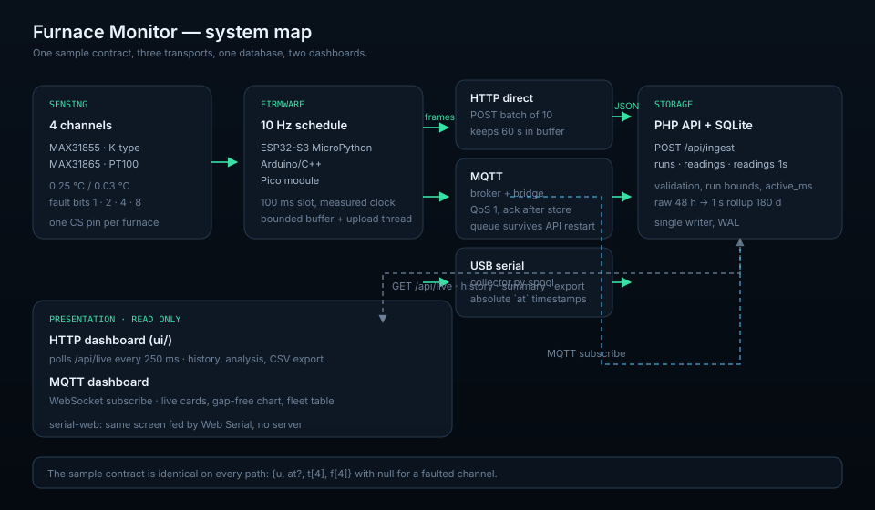

# Documentation

The repository documents three things separately: **how a piece works** (its
README), **how the pieces fit** (this folder), and **how to run the stack**
(root and MQTT READMEs).

## Start here

| If you are… | Read |
| --- | --- |
| Installing a board for the first time | [Hardware](hardware.md) → [`esp32-s3/`](../esp32-s3/README.md) → [Firmware](firmware.md) |
| Operating a furnace run | [System architecture](system-architecture.md) → [`ui/`](../ui/README.md) |
| Running the server | [`backend/`](../backend/README.md) → [Data model](data-model.md) |
| Adding another transport | [`MQTT/`](../MQTT/README.md) → [Protocol](../MQTT/docs/protocol.md) |
| Changing the dashboard | [`ui/`](../ui/README.md) → [`MQTT/docs/design-system.md`](../MQTT/docs/design-system.md) |
| Debugging missing data | [Troubleshooting](../README.md#troubleshooting) → [Testing](testing.md) |

## The system in one screen

Three ways to get a reading into the database, one storage model, two ways to
look at it:

| Path | Firmware | Transport | When to use |
| --- | --- | --- | --- |
| Direct | ESP32-S3 (MicroPython or Arduino) | Wi-Fi HTTP `POST /api/ingest` | One board per run, network available |
| MQTT | ESP32-S3 + `MQTT/firmware` | Broker → bridge → API | Lossy links, API restarts, fan-out |
| Collector | Pico or ESP32-S3 on USB | Serial CSV → `collector.py` → API | Bench testing, no Wi-Fi, replayable logs |

## Guides

* [System architecture](system-architecture.md) — layers, transports, deployment
  shapes, failure domains, capacity.
* [Hardware](hardware.md) — pin maps for both ESP32-S3 variants and the Pico,
  probe wiring, power, grounding, sensor selection, calibration.
* [Firmware](firmware.md) — the 100 ms loop, upload thread, supervisor and
  watchdog, fault codes, batching, clock handling.
* [Data model](data-model.md) — tables, run lifecycle, time anchoring, rollup
  and retention arithmetic.
* [Testing](testing.md) — every suite in the repository, what it proves and how
  to run it without hardware.
* [MQTT protocol](../MQTT/docs/protocol.md) and
  [operations](../MQTT/docs/operations.md) — the alternative transport.

## Component references

| Area | README |
| --- | --- |
| ESP32-S3 firmware (both flavours) | [`esp32-s3/README.md`](../esp32-s3/README.md) |
| MAX31855 thermocouple variant | [`esp32-s3/max31855/README.md`](../esp32-s3/max31855/README.md) |
| MAX31865 RTD variant | [`esp32-s3/max31865/README.md`](../esp32-s3/max31865/README.md) |
| Arduino/C++ sketch | [`esp32-s3/arduino/README.md`](../esp32-s3/arduino/README.md) |
| Raspberry Pi Pico firmware | [`module/README.md`](../module/README.md) |
| USB collector | [`collector/README.md`](../collector/README.md) |
| PHP API + SQLite | [`backend/README.md`](../backend/README.md) |
| HTTP dashboard | [`ui/README.md`](../ui/README.md) |
| Web Serial dashboard | [`serial-web/README.md`](../serial-web/README.md) |
| MQTT stack | [`MQTT/README.md`](../MQTT/README.md) |

## Conventions

* Temperatures are °C, times are Unix milliseconds unless a document says
  otherwise. `u` is always device uptime in milliseconds.
* Channel indexes are 0-based in JSON and 1-based in CSV/export columns, and
  every document states which one it means.
* Diagrams are hand-written SVG so they diff in review and render on GitHub
  without a build step.
* Code samples are copied from working code; commands are run in CI-less local
  checks (`python3 -m unittest`, `node --test`, `bash backend/tests/smoke.sh`).
* A document that describes behaviour must name the file that implements it.
