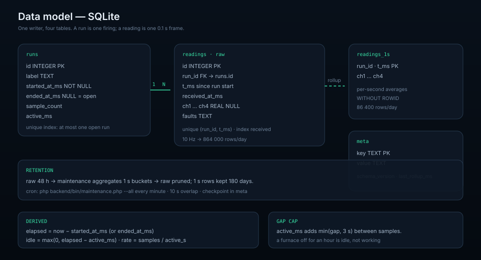

# Data model

SQLite, four tables, one writer. The schema is small because the hard parts are
in how rows are written, not in how many tables exist.



## Tables

Definitions live in [`backend/schema.sql`](../backend/schema.sql); the API never
lets a client write SQL.

### `runs`

| Column | Type | Meaning |
| --- | --- | --- |
| `id` | INTEGER PK | Run number shown in the UI |
| `label` | TEXT | Optional name (`Firing 42`) |
| `started_at_ms` | INTEGER NOT NULL | Wall clock of the first stored sample |
| `ended_at_ms` | INTEGER NULL | Set when the run is closed |
| `sample_count` | INTEGER | Frames stored for the run |
| `active_ms` | INTEGER | Time actually covered by samples |

A partial unique index guarantees **at most one open run**:

```sql
CREATE UNIQUE INDEX idx_runs_open
    ON runs ((ended_at_ms IS NULL)) WHERE ended_at_ms IS NULL;
```

Two ingest requests cannot both create a run: writes run inside
`BEGIN IMMEDIATE`, which serialises writers.

### `readings`

| Column | Type | Meaning |
| --- | --- | --- |
| `id` | INTEGER PK | Monotonic sample id used by `/api/live?since=` |
| `run_id` | FK → `runs.id` | `ON DELETE CASCADE` |
| `t_ms` | INTEGER | Milliseconds since `started_at_ms` |
| `received_at_ms` | INTEGER | Server arrival time |
| `ch1`…`ch4` | REAL NULL | °C, `NULL` for a faulted channel |
| `faults` | TEXT | Four bit masks, comma separated |

Indexes: unique `(run_id, t_ms)` (a re-delivered batch cannot double-insert the
same 0.1 s slot) and `received_at_ms` (sample-age queries).

### `readings_1s`

Per-second averages, `PRIMARY KEY (run_id, t_ms)` and `WITHOUT ROWID`, written by
the maintenance job. Kept for `FURNACE_AGGREGATE_RETENTION_DAYS` (180 by
default) after raw rows are pruned.

### `meta`

Key/value store for `schema_version`, the rollup checkpoint
(`last_rollup_ms`) and maintenance bookkeeping.

## Run lifecycle

```
idle ──ingest (no open run)──▶ open ──POST /api/runs/reset──▶ closed
                                  │                              │
                                  └──── next ingest opens a new one ◀┘
```

* The first batch into an empty database opens a run at its first sample's
  `at`, or at arrival when `at` is absent.
* `POST /api/runs/reset` closes the open run (`ended_at_ms = now`) and does not
  create a new one; the next sample opens it.
* An open run's `elapsed_ms` is computed on read (`now − started_at_ms`), so the
  timer keeps moving even while no data arrives.
* `sample_count` and `active_ms` are maintained at ingest; a closed run keeps
  its last values.

### `active_ms` and the gap cap

Ingest adds the distance between consecutive samples, capped at
`FURNACE_MAX_SAMPLE_GAP_MS` (3 s default):

```php
$activeMs += min($t - $previousT, $maxGapMs);
```

A 4 s silence therefore adds 3 s, not 4: a furnace that was off for an hour does
not claim an hour of working time. The dashboard derives:

| Shown | Formula |
| --- | --- |
| Run timer | `elapsed_ms` (wall clock, ticks while open) |
| Idle | `max(0, elapsed_ms − active_ms)` |
| Working rate | `sample_count / (active_ms / 1000)` |

## Time

Two clocks meet at ingest:

| Field | Origin | Used for |
| --- | --- | --- |
| `u` | Device uptime, ms | Placing frames inside a batch on the 0.1 s grid |
| `at` | Device NTP or collector | Absolute position of a frame |
| `received_at_ms` | Server | "last sample N s ago", gap detection |

Without `at`, the newest sample is anchored at arrival and the rest are placed
by uptime difference. That is correct for a live stream and wrong for a backlog,
which is why the collector always sends `at`.

`t_ms` is stored relative to the run start, so a run's timeline is independent
of later clock corrections.

## Retention arithmetic

| Data | Default | Rows/day at 10 Hz |
| --- | --- | --- |
| Raw `readings` | 48 h (`FURNACE_RAW_RETENTION_HOURS`) | 864,000 |
| `readings_1s` | 180 days (`FURNACE_AGGREGATE_RETENTION_DAYS`) | 86,400 |

Running `backend/bin/maintenance.php --all` once a minute keeps the checkpoint
moving; a 10 s overlap means a late batch is still aggregated. Pruning is by
age, not by run, so a long firing keeps its recent raw data.

## Query paths

| Endpoint | Reads | Resolution |
| --- | --- | --- |
| `/api/live` | `readings` after `since` | Raw, up to 600 rows |
| `/api/history` | `readings` ≤ 6 h, `readings_1s` beyond | Averaged buckets, ≤ 2000 points |
| `/api/summary` | Rollup above `FURNACE_ANALYSIS_ROLLUP_HOURS` | min/max/avg per channel |
| `/api/export` | Raw ≤ 6 h, 1 s ≤ 36 h, 1 min beyond | CSV stream |
| `/api/bounds` | `MIN/MAX` over runs | O(index) |

A stopped furnace still shows its last data because history is anchored to the
newest **recorded** sample, not to `now`.

## Migrations and backups

* The schema is created idempotently at boot and versioned in `meta`
  (`schema_version = 2`). A future migration bumps it and runs inside a
  transaction.
* Back up by copying the SQLite file while the API is idle, or with
  `sqlite3 backend/var/furnace.sqlite ".backup backup.sqlite"`.
* `--vacuum` in the maintenance job reclaims space after a large prune; it needs
  free disk equal to the database size.

## Related

* [`backend/README.md`](../backend/README.md) — endpoint reference and deployment
* [System architecture](system-architecture.md) — where ingest sits
* [Firmware](firmware.md) — how `u` and `at` are produced
