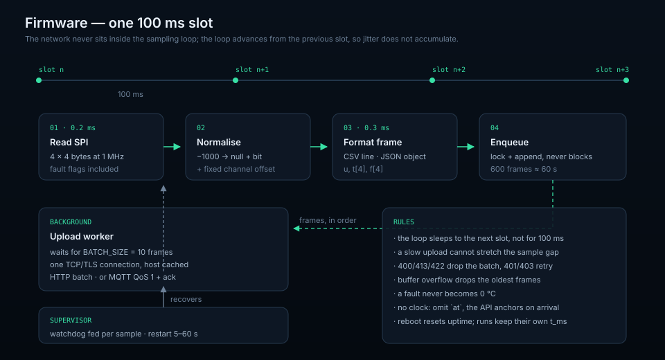

# Firmware

Three implementations, one contract: read the installed channels on a
configurable frame (400 ms by default on the ESP32-S3, 100 ms on the Pico) and
hand a `{u, t[4], f[4]}` frame to a transport. Unused slots are `null` with
fault `0`, never a fabricated temperature. The differences are the toolchain, the
sensor driver and how a frame leaves the board.



## Implementations

| | `esp32-s3/` MicroPython | `esp32-s3/arduino/` | `module/` Pico |
| --- | --- | --- | --- |
| Target | ESP32-S3, Wi-Fi or USB-only | ESP32-S3 (or ESP32), Wi-Fi | Raspberry Pi Pico, USB |
| Toolchain | Thonny / `mpremote` | Arduino IDE 2.x / `arduino-cli` | Thonny |
| Sensor | 3× MAX31855 or 4× MAX31865 | MAX31855 or MAX31865 | MAX31855 |
| Transport | HTTP batch or USB-only CSV | HTTP batch | CSV over USB (+ flash log) |
| Buffer | 600 frames (4 min at 400 ms) | 60 s ring | none on the wire; flash log rotates at 1 MB |
| Clock | NTP, `at` per batch; host collector in USB-only | NTP, `at` per batch | none; collector stamps time |
| Watchdog | hardware WDT + supervisor | task watchdog + retry loop | none (PC is expected) |

## The sampling loop

```
slot N                      slot N+1
  │                            │
  ├─ read the probes (SPI)      │     1–5 reads per channel at 0.5–1 MHz
  ├─ apply channel offset       │
  ├─ format CSV line            │     ~0.3 ms
  ├─ enqueue frame              │     lock + append, never blocks on network
  ├─ serial write (if enabled)  │
  └─ sleep until slot N+1       │     measured from the slot, not from sleep()
```

The MicroPython MAX31855 build spends most of the slot on its noise filter:
five reads per channel at 500 kHz, per-frame validation (reserved bits and the
internal cold-junction range), a majority quorum, a median per channel, then an
EMA across samples (≈76 ms for three furnaces), well inside the 400 ms default.
The MAX31865 and Arduino builds take one reading per channel and rely on the
probe's own filtering.

The next slot is computed from the *previous slot*, so jitter does not
accumulate: a slow serial write delays one sample, not every following one.
`ticks_ms()` (MicroPython) or `millis()` (Arduino) is the time column, measured —
not derived from sample counts.

A frame costs ~150 bytes queued in MicroPython; the default 600-frame buffer is
about 90 KB, modest for an ESP32-S3 but too much for an ESP8266.

## Transports

### HTTP batch

`ingest.py` (MicroPython) or `Uploader` (Arduino) keeps one TCP/TLS connection
and a host-name cache, then posts up to `BATCH_SIZE` frames (`1` on the ESP32-S3
MicroPython firmware) to `/api/ingest`. `API_URL` can be the host or the complete
`/api/ingest` URL; heartbeat and OTA normalise it to the API root. The heartbeat
posts over this same socket instead of opening a second TLS context. The socket
is deliberately short-lived (30 s by default) so a server or access point that
forgets an idle connection cannot leave the board writing into a half-open
socket. The API anchors a frame without `at` on arrival and places the rest on
the frame grid by uptime, so delivery does not distort the timeline.

* `BACKGROUND_UPLOAD = True` runs the POST on a thread, so a TLS handshake
  cannot stretch a sample gap.
* A failed POST keeps the batch and retries on the next flush.
* Any `2xx` response (`200`, `202 Accepted`, `204 No Content`) is a successful
  store; a proxy in front of the API may rewrite a 200 to 202.
* `400/413/422` are permanent: the batch is dropped instead of blocking the queue.
* `401/403` and DNS failures retry with a bounded exponential backoff, with a
  console hint.
* Beyond `BUFFER_LIMIT` the oldest frames are dropped, so RAM cannot fill.
* Each request is capped at `BATCH_SIZE`; a long backlog is sent in several
  requests instead of one huge JSON/TLS allocation. Under heap pressure the
  queue is trimmed further and only one TLS session is opened at a time.
* The keep-alive socket is retired after `API_KEEPALIVE_S` (30 s), on a failed
  exchange, or when the server closes it. Every socket operation has a timeout;
  a worker that stops making progress has its socket reset, and a minute without
  a successful upload forces a Wi-Fi re-association.

See [`esp32-s3/README.md`](../esp32-s3/README.md#behaviour) for the full list.

### MQTT batch

[`MQTT/firmware/furnace_mqtt.py`](../MQTT/firmware/furnace_mqtt.py) publishes the
same batch with QoS 1 and removes frames only when the bridge acknowledges the
batch `seq`. The retained `state` topic plus Last Will is the presence contract.
Details: [`MQTT/firmware/README.md`](../MQTT/firmware/README.md).

### Serial / collector

The Pico prints one CSV line per sample:

```
12300,781.25,-1000.00,940.00,545.75
```

`collector.py` parses it, maps uptime to wall-clock time, appends JSON lines to
a checkpointed spool and uploads batches of 100. `-1000.00` becomes `null` with
fault bit 8. An ESP32-S3 can use this transport without Wi-Fi: set
`USB_ONLY = True` in `config.py`, connect its CH343 USB-UART port to a
Raspberry Pi/OpenWrt host, and run the collector there. The host owns the
USB-to-LAN adapter; the board never creates a WLAN or uploader. See
[`collector/README.md`](../collector/README.md#usb-only-esp32-s3-through-a-usb-to-lan-host).

## Remote updates

The MicroPython board updates when an operator presses **Update firmware** in
the admin panel; there is no periodic check. The next heartbeat delivers the
`ota` command, and only then does the board fetch a bundle. A USB-only board has
no heartbeat, so update it over USB. The Arduino build still needs a USB flash.
A bundle is a manifest plus plain `.py` files:

```
admin panel ── ota ──▶ heartbeat reply ── check ──▶ GET /api/firmware/manifest?channel=max31855
                        │ version differs
                        ▼
              GET /api/firmware/file?name=main.py   (one per changed file)
                        │ verify size + sha256 + compile
                        ▼
                  /ota/stage  ── pending.json ──▶ reboot
                        │
boot.py ──── apply ─────┴─▶ backup replaced files ──▶ reboot into new code
                        │
main.py ── 60 s healthy ──▶ confirm: delete /ota/backup
                        │
              crash ×3 before confirm ──▶ restore /ota/backup
```

Rules that make this safe to run unattended:

* Only names listed in the manifest are written, and only into the board root.
* Each file is checked against its SHA-256 and compiled before it replaces
  anything; a truncated download never reaches `main.py`.
* `config.py` is never part of a bundle, so an update cannot break the Wi-Fi or
  the API key.
* The previous file set is kept until the new firmware has run for a minute;
  three unconfirmed boots restore it automatically.
* Sampling is not paused for the check: the download runs in the heartbeat
  thread, and the reboot waits until the sample queue has been flushed.
* A `404` (nothing published yet) fails that one command; nothing is retried
  until the operator asks again.

## Heartbeat and commands

`device.py` reports every 15 s to `POST /api/device/heartbeat` with the source
(`max31855`/`max31865`), firmware version, IP, RSSI, uptime and queue depth, and
acknowledges each command with `POST /api/device/ack`. Four commands exist:

| Command | Effect on the board |
| --- | --- |
| `ota` | One bundle check; stage and reboot if the version differs |
| `wifi` | Write `/wifi.json`, acknowledge, reboot; `wifi.py` prefers it over `config.py` |
| `restart` | Acknowledge and reboot |
| `settings` | Apply sample interval, noise filter, heartbeat, per-channel enabled/base offset and temperature bands; save `/settings.json` |

The heartbeat reply also carries the saved settings snapshot, so a board whose
files were replaced recovers the operator's configuration on its next poll
without a new command. A `2xx` heartbeat is accepted as success, including a
proxy's `202 Accepted`. A disabled channel is uploaded as `null` with fault `0`,
exactly like a probe that is not installed.

A command stays queued on the server until acknowledged, so a board that was
offline applies it when it returns. The heartbeat thread never touches the
sampling loop; a slow request only delays the next heartbeat.

Publishing is one command per release; see
[`esp32-s3/README.md`](../esp32-s3/README.md#remote-updates-ota) for the bundle
layout and the console lines.

## Boot and supervision

`boot.py` runs before the application and prints the reset cause and any missing
module. It also arms the hardware watchdog before importing `main.py`, so a
syntax error or failed import cannot leave a charger-powered board frozen at a
REPL with no network. `supervisor.py` reuses that boot instance and feeds it
from the sampling loop; it does not create a second WDT, which the ESP32 cannot
reconfigure safely. A `WDT_RESET` in the banner means the application stopped
feeding the watchdog, which is the fastest way to tell a crash from a power cut.

`supervisor.py` wraps a session:

```
start → connect Wi-Fi (unless USB-only) → NTP (optional) → sampling loop
   ▲                                          │
   └── restart after 5–60 s backoff ◀── exception / hang
```

* The watchdog is fed once per sample and during Wi-Fi waits, so a hung loop
  reboots the board instead of freezing it.
* A crash inside a session is logged and the session is rebuilt with an
  exponential backoff (5 s → 60 s).
* A dead upload thread is detected and restarted by the loop.
* No keyboard, reset button or computer is needed after the first upload; see
  [`esp32-s3/README.md`](../esp32-s3/README.md#running-from-a-charger-no-computer).

## Faults

Each channel carries a bit mask. The firmware turns a fault into `null` plus the
mask; the serial line keeps `-1000.00` so a broken probe never looks like 0 °C.

| Bit | Meaning | Firmware source |
| --- | --- | --- |
| 1 | Open thermocouple | MAX31855 fault register `0x1` |
| 2 | Short to GND | `0x2` |
| 4 | Short to VCC | `0x4` |
| 8 | Read error / general fault | `0x10000`, SPI failure, or `-1000` on the serial line |

A faulted channel ignores its calibration offset. On the dashboard it renders
as *held*: the last good value stays visible and the chart continues, so a
one-frame glitch does not erase the trend. A fault that persists shows as a
flat line plus the held marker; the fault reason is in the card tooltip.

## Clock handling

| Firmware | Clock | `at` |
| --- | --- | --- |
| ESP32-S3 MicroPython | NTP after Wi-Fi | Sent once per batch when synced |
| Arduino | `configTime()` | Sent once per batch when synced |
| Pico | none | Omitted; the collector maps uptime to PC time |

Wall-clock time is the *newest* frame in the batch. The bridge and the API place
earlier frames by their uptime distance, which preserves the frame grid.

A reboot resets uptime to 0. The API only uses differences within a batch, and
MQTT deduplication treats a backward jump larger than 1000 as a reboot, so a
fresh boot is never discarded.

## Calibration

* MAX31855: set the base offset per channel in the admin panel; it is stored in
  `/settings.json` and applied before serial/upload. Add up to 12 temperature
  bands where the error changes with temperature; a band replaces the base
  offset inside `[min, max)`. `CHANNEL_OFFSETS` in `max31855/main.py` is only the
  first-boot/default fallback. See
  [`max31855/README.md`](../esp32-s3/max31855/README.md#per-furnace-offset-and-temperature-bands).
* MAX31865: `R_REF`, `R_NOMINAL`, `WIRE_MODE`, `FILTER_HZ` must match the board
  and probe. See [`max31865/README.md`](../esp32-s3/max31865/README.md).
* Arduino: the same options live in `config.h`; the maths is identical.

## Adding a sensor

A new driver only has to return, for each channel, a temperature in °C or
`null`, plus a fault mask. Everything downstream (offsets, CSV, JSON, batching,
storage, dashboards) works unchanged. Keep the read inside the frame slot (400 ms by default): at
0.5–1 MHz a 4-byte transfer is ~0.2 ms, but the stock MAX31855 filter already
uses ~76 ms of the slot, so there is room for a slightly longer frame, not for
a blocking network call.

## Related

* [Hardware](hardware.md) — pins, probe wiring, power
* [Data model](data-model.md) — what happens to a frame after upload
* [`esp32-s3/README.md`](../esp32-s3/README.md) — install, configuration, TLS
* [`module/README.md`](../module/README.md) — Pico CSV protocol and flash log
