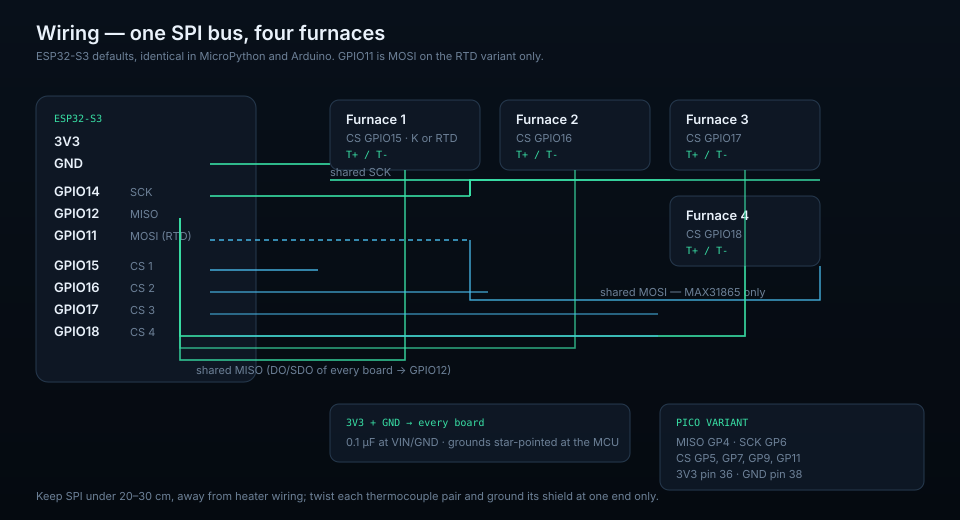

# Hardware

Two supported sensing variants on the ESP32-S3, plus the Raspberry Pi Pico
module. All of them present the same four channels to the firmware, so the
software never needs to know which probe is fitted.



## Bill of materials

| Part | Role | Notes |
| --- | --- | --- |
| ESP32-S3 dev board | Wi-Fi MCU | Any module with the pins below free; 3.3 V logic |
| 4 × MAX31855 breakout | K-type thermocouple | Read-only SPI, 0.25 °C resolution |
| *or* 4 × MAX31865 breakout | PT100/PT1000 RTD | Full-duplex SPI, 0.03 °C typical |
| 4 × probe | Sensing element | K-type or 3-wire PT100 depending on the board |
| 3.3 V supply | Power | USB or a 5 V→3.3 V regulator; ≥ 500 mA headroom |
| 4 × 0.1 µF | Decoupling | One per amplifier, close to VIN/GND |

## ESP32-S3 pins

The MicroPython variants and the Arduino sketch use the *same* defaults, so a
board can be reflashed between toolchains without rewiring.

### MAX31855 (thermocouple)

| ESP32-S3 | Signal | MAX31855 (all four) |
| --- | --- | --- |
| 3V3 | Power | `VIN` / `VCC` / `3V3` |
| GND | Ground | `GND` |
| GPIO14 | SCK | `CLK` / `SCK` |
| GPIO12 | MISO | `DO` / `SO` / `MISO` |
| GPIO15 | CS 1 | `CS` of furnace 1 |
| GPIO16 | CS 2 | `CS` of furnace 2 |
| GPIO17 | CS 3 | `CS` of furnace 3 |
| GPIO18 | CS 4 | `CS` of furnace 4 |
| — | — | every `DO` joins GPIO12 |

The MAX31855 has no MOSI, so GPIO11 stays free on this variant.

### MAX31865 (PT100 / PT1000)

| ESP32-S3 | Signal | MAX31865 (all four) |
| --- | --- | --- |
| 3V3 | Power | `VIN` |
| GND | Ground | `GND` |
| GPIO14 | SCK | `CLK` |
| GPIO11 | MOSI | `SDI` |
| GPIO12 | MISO | `SDO` |
| GPIO15–18 | CS 1–4 | `CS` |
| — | IRQ | `DRDY` left unconnected |

GPIO11/12/13/14 are the ESP32-S3's default SPI2 pins. The driver runs at 1 MHz,
SPI mode 1; the reference resistor and probe type are configured in
`max31865/main.py` (`R_REF`, `R_NOMINAL`, `WIRE_MODE`, `FILTER_HZ`).

### Raspberry Pi Pico (module/)

| MAX31855 | Pico pin | Notes |
| --- | --- | --- |
| VIN | 3V3 (OUT), pin 36 | 3.3 V only |
| GND | GND, pin 38 | Common ground |
| DO | GP4, pin 6 | Shared MISO |
| CLK | GP6, pin 9 | Shared SCK |
| CS 1–4 | GP5, GP7, GP9, GP11 | Pins 7, 10, 12, 15 |

The Pico has no Wi-Fi in this design: it writes CSV to USB and optionally keeps
a rolling flash log.

## Probe wiring

### K-type thermocouple (MAX31855)

* `T+` to `T+`, `T-` to `T-`. Reversed polarity reads a *falling* temperature
  while the furnace heats.
* Use a twisted pair per probe, shield grounded at **one** end only.
* Grounded junctions in a mains-powered furnace inject noise; a floating
  junction or an isolated amplifier removes most of it.
* The MAX31855 measures its own cold junction, so the board must sit at a
  stable temperature — not on the furnace shell.

### RTD (MAX31865)

| Probe | Terminals | `WIRE_MODE` | Board jumper |
| --- | --- | --- | --- |
| 2-wire | `RTD+`↔`FORCE+`, `RTD-`↔`FORCE-` | `2` | 2/3-wire |
| 3-wire | `RTD+`, `RTD-`, third lead to `FORCE-` | `3` | 2/3-wire |
| 4-wire | all four terminals | `4` | cut/solder the 4-wire jumper |

2-wire adds the lead resistance (≈0.4 °C per 0.1 Ω on PT100), so a long run
reads hot. Use 3-wire for furnace probes; 4-wire when accuracy matters most.
`R_REF` must match the resistor fitted on the board: 430 Ω for PT100,
4300 Ω for PT1000.

## Power and grounding

* Power the amplifiers from **3.3 V**. The logic pins are not 5 V tolerant on
  every breakout and the ESP32-S3 is a 3.3 V part.
* One decoupling capacitor per board, at VIN/GND, not at the far end of the
  bus.
* Star-ground the four boards at the MCU's GND pin; do not chain grounds
  through the probe shields.
* Keep SPI runs under ~20 cm (ESP32-S3) or ~30 cm (Pico) and away from heater
  wiring and contactors.
* A 1 MHz clock is deliberately slow: wiring and noise are far more likely to
  cause faults than timing.

## Calibration

Each channel can carry a fixed offset in `esp32-s3/max31855/main.py`:

```python
CHANNEL_OFFSETS = [0.0, 0.0, 0.0, 0.0]   # °C, one per CS pin
```

The offset is applied before the serial line and the upload, so CSV, database
and dashboard all show the corrected value. Fill it as
`reference thermometer − reading` at a working temperature. A faulted channel is
never offset: it stays `-1000.00` on serial and `null` in JSON.

The RTD path has no offset table; its error is dominated by `R_REF`,
`R_NOMINAL` and wire mode, which are configured in `max31865/main.py`.

## Choosing a sensor

| | MAX31855 + K-type | MAX31865 + PT100 |
| --- | --- | --- |
| Range | −270…+1372 °C (probe dependent) | −200…+850 °C |
| Accuracy | about ±2 °C | about ±0.5 °C with a good probe |
| Wiring | 2 leads, polarity matters | 2/3/4 leads, polarity irrelevant |
| Cost | lower | higher |
| Furnace use | general monitoring | soak control, tight tolerances |

## Safety

This is a monitoring prototype, not a safety-rated controller. Keep the
independent hardware limit controller and thermal cut-out; never rely on the
dashboard, the API or a phone to interrupt a firing.

## Related

* [Firmware](firmware.md) — how these pins are read and scheduled
* [`esp32-s3/max31855/README.md`](../esp32-s3/max31855/README.md) — offsets, accuracy
* [`esp32-s3/max31865/README.md`](../esp32-s3/max31865/README.md) — board jumpers, driver
* [`module/README.md`](../module/README.md) — Pico pin table and flash log
