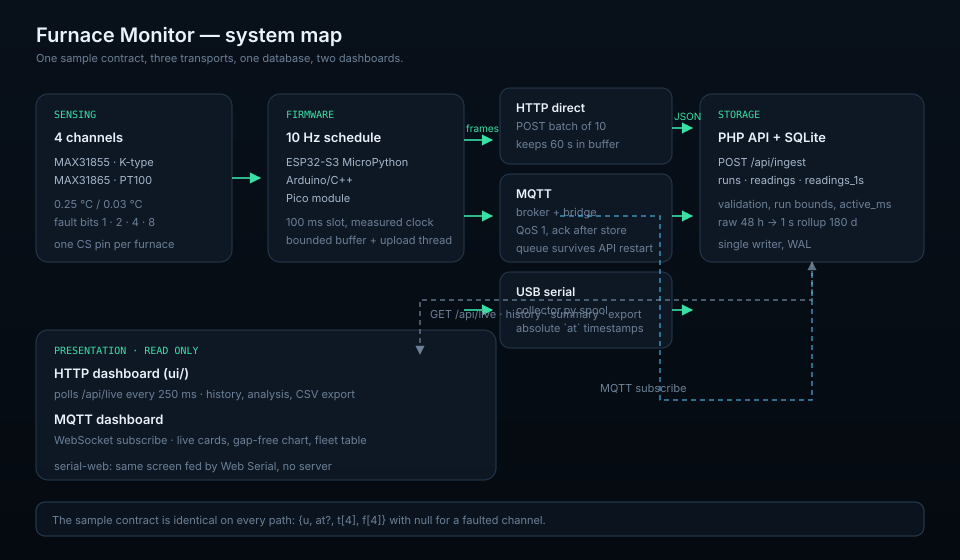

# System architecture

Four layers, three transports and one database. The point of the split is that
a failure in one layer is visible and bounded: a probe fault never becomes a
0 °C reading, a network outage never stops sampling, and an API restart never
loses a frame.



## Layers

| Layer | Components | Owns | Fails visibly as |
| --- | --- | --- | --- |
| **Sensing** | MAX31855 / MAX31865 ×4 | 0.25 °C / 0.03 °C conversion, fault bits | A channel goes `null` plus a fault bit |
| **Firmware** | ESP32-S3 MicroPython, Arduino sketch, Pico module | Configurable schedule (400 ms default on ESP32), buffering, upload | Console banner, watchdog reboot, retained state topic |
| **Transport** | Wi-Fi HTTP, MQTT bridge, USB collector | Delivery and retry | API offline banner, bridge `queued` counter, collector spool |
| **Storage** | PHP API + SQLite | Validation, run boundaries, retention | HTTP 4xx/5xx, `ingest.last_received_at_ms` stopping |
| **Presentation** | `ui/`, `serial-web/`, MQTT dashboard | Rendering only | Stale chip, held cards, gap-free chart |

Presentation never writes. Storage never samples. Firmware never knows the
database exists.

## Transports

### Direct HTTP (`esp32-s3/`, default)

```
board ──POST /api/ingest (batch of 10)──▶ PHP ──▶ SQLite
```

The board keeps one TCP/TLS connection and batches ten frames per request. The
API anchors the batch on arrival and places the frames back on the frame grid
using `u`, so network latency does not distort the timeline. The board buffers
600 frames (60 s) if the API is unreachable.

### MQTT (`MQTT/`)

```
board ──QoS 1──▶ Mosquitto ──▶ bridge ──POST──▶ PHP ──▶ SQLite
                     ▲            │
                     └─── ack ◀───┘
```

The broker absorbs API restarts, the bridge acknowledges only after storage, and
the dashboard can subscribe directly for low-latency fan-out. See
[`MQTT/docs/architecture.md`](../MQTT/docs/architecture.md).

### Serial collector (`collector/`)

```
Pico / ESP32-S3 ──USB CSV──▶ collector.py ──JSON batches──▶ PHP
```

The collector stamps each line with an absolute time and keeps a checkpointed
spool, which makes a replay after a laptop crash idempotent enough for a
monitoring prototype. It is the only path that can upload history with real
timestamps.

## A frame's journey

1. **Sample.** Three (MAX31855) or four (MAX31865) SPI channels in one frame
   (400 ms on the ESP32-S3); the MAX31855 build medians five reads per channel before smoothing
   them with an EMA. The MAX31855 returns 14 bits plus three fault flags; the
   MAX31865 returns a resistance ratio, converted with the Callendar–Van Dusen
   polynomial.
2. **Normalise.** Faulted channels become `null` with a fault bit; the firmware's
   `-1000.00` sentinel exists only on the serial line so a fault is never
   mistaken for a temperature.
3. **Buffer.** The frame joins a bounded queue. Nothing in the sampling path
   waits for the network.
4. **Deliver.** HTTP batch, MQTT batch with ack, or serial line to the collector.
5. **Store.** `/api/ingest` validates 1–600 samples, resolves the active run,
   anchors time and inserts rows in one transaction.
6. **Read.** The dashboard polls `/api/live` every 250 ms; the MQTT dashboard
   subscribes to the same batches in parallel.

## Run identity

A *run* is one firing. `POST /api/ingest` opens one if none is active; the
dashboard's **Start new run** closes it and opens the next. Every sample belongs
to exactly one run, and three quantities live beside it:

| Field | Meaning | Source |
| --- | --- | --- |
| `started_at_ms` | Wall clock of the first stored sample | First batch |
| `ended_at_ms` | When the run was closed | `POST /api/runs/reset` |
| `elapsed_ms` | Wall-clock age, live | Computed on read |
| `active_ms` | Time actually covered by samples, gaps capped | Computed at ingest |

The dashboard timer follows `elapsed_ms`; idle time is `elapsed_ms - active_ms`
and the working rate is `sample_count / active_ms`. See
[Data model](data-model.md#run-lifecycle).

## Deployment shapes

| Shape | Layout | Notes |
| --- | --- | --- |
| Bench | Laptop: API + UI + simulator | `php -S`, `python3 -m http.server`, `backend/bin/seed_demo.php` |
| Small site | One host: Apache/Nginx + PHP + SQLite; boards on Wi-Fi | Browser dashboard on the same origin |
| Two hosts | API host + static dashboard host | CORS allow-list, HTTPS on both |
| MQTT site | API host + broker + bridge + static dashboards | Ports 1883/9001 internal, 8883/9002 TLS |
| Multi-site | One bridge per site, shared broker and API | `FURNACE_MQTT_SITE` scopes each bridge |

SQLite is a single writer. Up to a few dozen furnaces at 1 request/s each is
comfortable; beyond that the API transaction, not the transport, is the limit.

## Security boundaries

* **Devices** hold only the ingest key (HTTP) or their own broker account (MQTT).
  They cannot read other devices' data.
* **Bridge** holds the ingest key and a broker account limited to samples/ack.
* **Browsers** hold nothing: the HTTP dashboard relies on CORS, the MQTT
  dashboard on a read-only broker account.
* **API** trusts only allow-listed origins for writes and never sends cookies.
* **Database** is a file under `backend/var/`, never served by the web server.

## Failure domains

| Failure | Blast radius | Recovery |
| --- | --- | --- |
| One probe | One channel | `null` + fault bit; other channels unaffected |
| One board | One run's live data | Buffer, reconnect, resume; retained MQTT state shows offline |
| Wi-Fi | Upload only | Sampling continues into the buffer |
| API down | Writes | Board buffer (60 s), bridge queue (500 batches), collector spool |
| Disk full | Writes | API returns 5xx; retention job must be checked |
| Dashboard down | View only | Nothing to recover; it is read-only |

## Design principles

1. **Sample first, deliver second.** No network call sits inside the sampling loop.
2. **The database is the truth.** Broker persistence, board buffers and spools
   are caches with a documented size, not a second source of truth.
3. **A missing value is not zero.** `null` travels end to end and renders as
   *held* or dashes, never as a plausible number.
4. **Time is explicit.** `u` is device uptime, `at` is wall clock, and every
   layer states which it stores.
5. **One contract, three transports.** All paths produce the same sample object,
   so storage, export, analysis and both dashboards are transport-agnostic.

## Related

* [Hardware](hardware.md) — wiring and pin maps
* [Firmware](firmware.md) — the loop and its timing budget
* [Data model](data-model.md) — tables, retention, queries
* [Testing](testing.md) — what is verified without hardware
