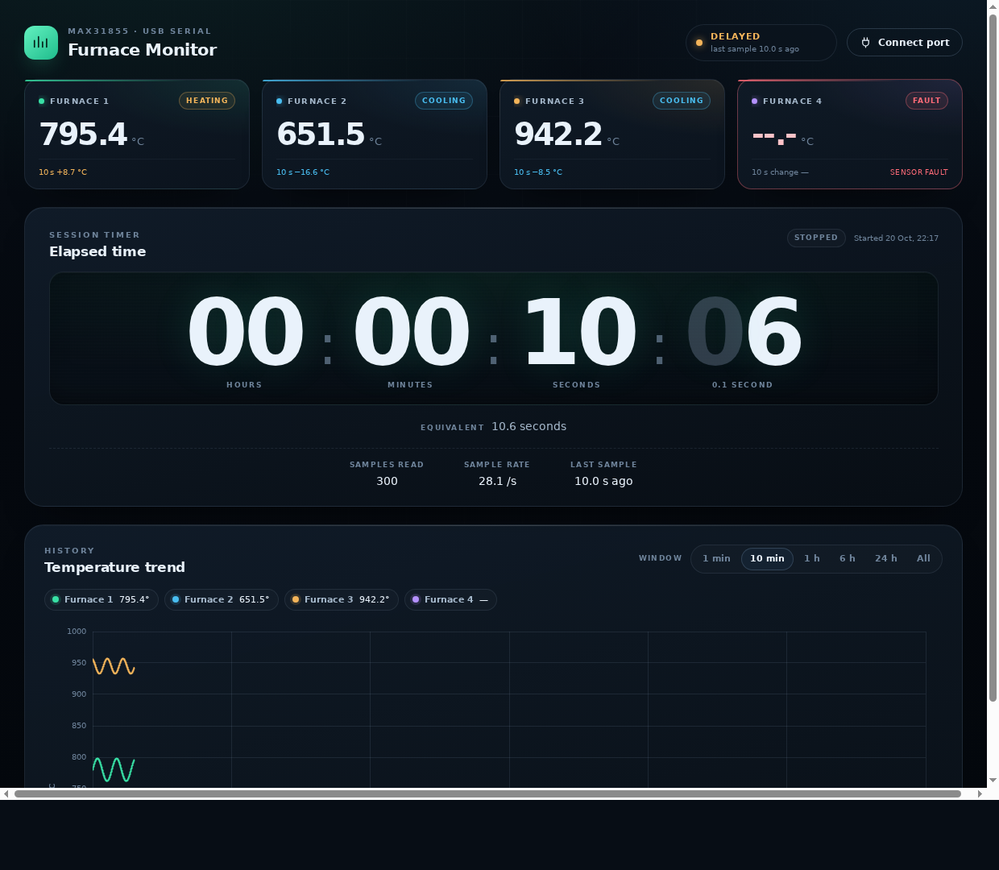

# Serial web monitor

The same dashboard as [`ui/`](../ui) — Razi Applied Science Foundation branding,
colour-matched card borders, recorded-time timer, cards, chart and design
tokens, with the timer at the top and everything on one screen that never
scrolls — fed directly from the USB serial port with the browser's Web Serial
API. No backend, no collector, no database.



## What the Pico must send

In `module/config.py`:

```python
SERIAL_FORMAT = "csv"   # default in config.example.py
SERIAL_ECHO = True
```

The firmware prints a header once, then one line per sample (10 per second):

```
ms,furnace1,furnace2,furnace3,furnace4
12300,781.25,660.00,940.00,545.75
12400,781.25,660.00,940.00,-1000.00
```

The ESP32-S3 firmware in [`esp32-s3/`](../esp32-s3/README.md) prints exactly the
same line while it uploads over Wi-Fi, so this page works with those boards
through their CH343 USB port too.

`-1000.00` means that channel reported a fault. The page shows `--.-`, marks
the card red and draws a gap in the chart. JSON lines
(`{"u":…,"t":[…],"f":[…]}`) are accepted too, so `SERIAL_FORMAT = "json"`
still works.

The flash log on the Pico stays JSON, so `collector/` can upload it later.

## Run it

1. Close Thonny, Serial Studio and `collector.py` — a serial port can only be
   open in one program at a time.
2. Serve this folder (Web Serial needs `localhost` or HTTPS):

   ```bash
   cd serial-web
   python -m http.server 8080
   ```

3. Open <http://localhost:8080> in **Chrome or Edge**. Firefox and Safari do
   not implement Web Serial at all: the page detects that, disables the button
   and says so instead of failing on every click. Mobile browsers cannot open a
   serial port either.
4. Click **Connect port** and pick the board (`USB Serial Device (COM5)`, or
   `USB-Enhanced-SERIAL CH343 (COM6)` on an ESP32-S3).

The picker is a browser security requirement: a page may not open a port by
name without the user choosing it once. Press the button again to disconnect.

### Where is the port set?

`COM5` never appears in the code. The browser does not let a page name a port,
so the operator picks it in the dialog; Chrome remembers the permission for
that site afterwards. Only two settings live in
[`assets/js/serial.js`](assets/js/serial.js):

```js
const BAUD_RATE = 115200;   // must match the firmware
const AUTO_CONNECT = true;  // reopen the allowed port
```

Which devices the dialog offers is set by `PORT_FILTERS` in
[`assets/js/ports.js`](assets/js/ports.js). It is **empty on purpose**: an empty
list shows every serial port, so a Pico, an ESP32-S3 with a CH343 bridge
(`USB-Enhanced-SERIAL CH343 (COM6)`, vendor `0x1a86`) and any other USB serial
adapter all appear. A list like `[{ usbVendorId: 0x2e8a }]` makes Chrome hide
everything else — the list stays empty and no port can be picked — while a
desktop app such as Serial Studio still opens the same port, because it does not
use the browser picker. Narrow the list only when the machine has other serial
devices worth hiding. To check what the browser sees, open the console and run
`await navigator.serial.getPorts()`.

With `AUTO_CONNECT = true`, a page reload reopens the port the operator already
allowed, without the picker, and it reopens the one it remembers rather than
the first granted device when the site may use several. Set it to `false` to
choose the port by hand every time. Unplugging the cable is detected and the
page returns to “Ready”.

## Serial Studio

Point Serial Studio at the same port, **Quick Plot**, 115200 baud. The first
line is text, so it becomes the channel labels and the numeric rows after it
are plotted. `-1000` shows as a sharp dip, which makes a faulted probe obvious.
To fix the channel names and units instead of the header row, `-1000` can be
mapped in a Project File.

## How it works

`index.html` is the `ui/` layout. `assets/js/serial.js` replaces the API client:

1. `navigator.serial.requestPort()` opens the port, `readable` is decoded as
   UTF-8 text and split on newlines.
2. Each line becomes a frame (`u` uptime + four temperatures, `null` for a
   fault). A Pico reboot (uptime going backwards) starts a new session.
3. Frames are appended to the same `TemperatureChart` class used by `ui/`,
   using uptime differences, so the 0.1 s grid stays exact.
4. The timer counts frames, so it shows **recorded** time: unplugging the Pico
   or a silent port freezes it instead of counting wall-clock time. The *Idle*
   stat shows how much of the session had no frames.
5. Cards, legend, timer, window buttons and toasts run the same formatting
   helpers (`format.js`) as the API dashboard.

### Recorded-time timer

The counter is not a wall-clock stopwatch and does not keep running while the
port is quiet. It is `state.samples * 0.1 s`: one frame is one tenth of a
second, so ten frames advance the counter by exactly one second. The last two
digits are hundredths and count `00`–`99`: between two frames they run on by the
part of the frame gap that has already passed, stopping short of the next frame
so the display never rewinds, and they settle on the frame count as soon as the
port goes quiet. The same rule applies on the API dashboard through
`runs.sample_count`, so both pages read the same duration. Disconnecting stops
the counter; reconnecting opens a new session because the Pico's uptime
restarts.

Styles, `format.js` and `chart-panel.js` are copied from `ui/`, so the pages
look identical. Change them in `ui/` first, then copy the files over:

```bash
cp ui/assets/css/tokens.css ui/assets/css/app.css serial-web/assets/css/
cp ui/assets/js/format.js ui/assets/js/chart-panel.js serial-web/assets/js/
cp ui/assets/img/logo-razi.svg ui/assets/img/favicon.svg serial-web/assets/img/
```

The copied `tokens.css` also contains the light palette, but this page never
sets `data-theme`, so it is always the dark dashboard.

For a quick check without hardware, open the browser console and run
`furnaceSerial.applyFrame(furnaceSerial.parseLine('100,700,650,940,545'))`;
the cards and chart update exactly as they would from the port.

## Files

| File                            | Purpose                                    |
| ------------------------------- | ------------------------------------------ |
| `index.html`                    | Dashboard markup (same as `ui/index.html`) |
| `assets/js/serial.js`           | Web Serial reader and UI controller        |
| `assets/js/ports.js`            | Port picker filters and support messages   |
| `assets/js/chart-panel.js`      | Chart, copied from `ui/`                   |
| `assets/js/format.js`           | Number/timer formatting, copied from `ui/` |
| `assets/css/`                   | Design tokens and layout, copied from `ui/`|
| `assets/img/logo-razi.svg`      | Foundation mark, copied from `ui/`          |
| `assets/vendor/chart.umd.min.js`| Chart.js 4, copied from `ui/`              |

Nothing is written to disk; closing the tab ends the session. For a permanent
history, use `collector/` and the API dashboard instead.

## Troubleshooting

| Symptom                              | Check                                                     |
| ------------------------------------ | --------------------------------------------------------- |
| Dialog opens with no port to pick    | `PORT_FILTERS` in `assets/js/ports.js` must be `[]`; the   |
|                                      | list hides devices whose USB ids do not match             |
| `Web Serial is not available…`       | Chrome or Edge, and open the page from `http://localhost`  |
| Button says `Chrome or Edge only`    | Firefox/Safari have no Web Serial; use Chrome, Edge or Opera |
| `…needs a secure page`               | A LAN address over plain http never exposes Web Serial;    |
|                                      | use `localhost` or serve the folder over HTTPS            |
| `Could not open the port…`           | Close Thonny/Serial Studio/collector; replug the Pico      |
| Connects but stays on “Waiting”      | `SERIAL_FORMAT = "csv"`, `SERIAL_ECHO = True`, 115200 baud |
| Every card shows `--.-`              | Run `module/check.py` on the Pico to see the sensor fault  |
| Chart is empty on a fresh page       | It fills when the first numeric line arrives               |
