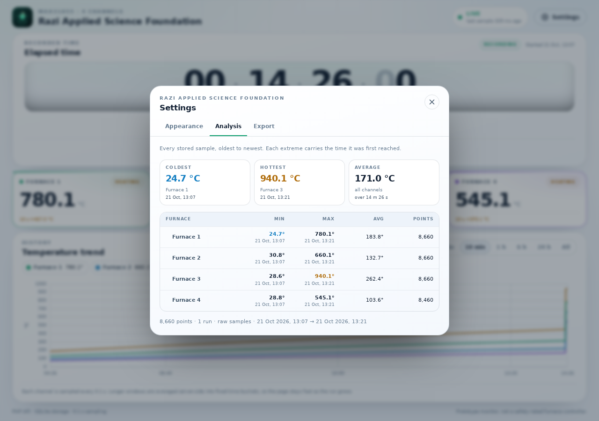

# Web app

A standalone static dashboard: plain HTML, CSS custom properties and ES
modules. There is no build step and no npm install; Chart.js is vendored so the
page works without a CDN.

This folder is deployed on its **own web server**, separate from the PHP API:

| Service | Production URL |
| ------- | -------------- |
| UI (this folder) | <https://temp.futurefounderco.com> |
| API | <https://apitemp.futurefounderco.com> |

## Screens

1. Branded app bar: the foundation logo, **Razi Applied Science Foundation**,
   the connection status and a **Settings** button (a gear on a phone).
2. Recorded-time timer: eight digit positions `HH:MM:SS:CC`, with
   days/hours/minutes spelled out below, plus sample count, working rate, idle
   time and last-sample age. It pauses when samples stop; **Start new run**
   lives in Settings → Appearance.
3. Four furnace cards, under the timer: name, colour, live temperature,
   10-second change, a heating / cooling / holding state, and a border in the
   same colour as that furnace's chart line. A faulted channel shows `--.-`
   and the decoded fault reason.
4. Chart: four linear series on one canvas, a custom legend that doubles as a
   series toggle, window presets (1 min, 10 min, 1 h, 6 h, 24 h, all) and an
   empty state while waiting for the first sample.


5. Settings dialog with three tabs:
   - **Appearance** — dark / light / system theme and *Start new run*;
   - **Analysis** — range presets (1 h, 6 h, 24 h, 7 d, 30 d, all, custom) or
     custom date-time pickers, coldest / hottest / average highlights, and
     min/max/avg/points per furnace;
   - **Export** — CSV download of the selected range, furnace chips that pick
     the exported columns, and auto/raw/1 s / 1 min resolution.

Installing the dashboard as a PWA uses the browser's own install prompt (there
is no separate App tab).

The three blocks fill exactly one screen: the page itself never scrolls. The
chart is the flex row that absorbs the remaining height, so a phone in portrait
and a laptop window both show the same information without scrolling.

## Configuration

`config.js` is loaded before the app and selects the API origin:

```js
const isLocalHost = ['localhost', '127.0.0.1', '::1'].includes(window.location.hostname);

window.FURNACE_CONFIG = {
  apiBaseUrl: isLocalHost
    ? 'http://localhost:8080'
    : 'https://apitemp.futurefounderco.com',
};
```

- Production is untouched: opening the site on `temp.futurefounderco.com`
  calls `https://apitemp.futurefounderco.com`.
- Local development with `python3 -m http.server 3000 --directory ui` calls
  `http://localhost:8080`.
- Set `apiBaseUrl: ''` when both the UI and the API are published under one
  reverse-proxy origin.
- There is no trailing slash and no `/api` suffix; the client appends paths.

The API must allow this origin through CORS. The backend default includes
`https://temp.futurefounderco.com`, `http://localhost:3000` and
`http://127.0.0.1:3000`, and any **loopback** page (`localhost`/`127.0.0.1`)
is accepted on every port, so `python -m http.server 5500`, Live Server or a
framework dev server all work without an extra entry. A page opened straight
from disk (`file://`) can read the data but cannot start a new run. Override
`FURNACE_ALLOWED_ORIGINS` on the API host when you deploy the UI on another
host — a LAN address such as `http://192.168.1.50:3000` is not loopback and
must be listed.

## Files

```
index.html                  markup, timer, furnace cards, chart, settings dialog
manifest.webmanifest        PWA name, colours, 192/512/maskable icons
sw.js                       offline shell cache (never caches the API)
config.js                   API origin for the current deployment
assets/css/tokens.css       design tokens, dark + light palettes, reset
assets/css/app.css          layout, cards, chart, dialog and responsive rules
assets/js/theme-boot.js     applies the saved theme before the first paint
assets/js/main.js           state, DOM updates, events, timer, settings, export
assets/js/feed.js           chained /api/live polling with backoff
assets/js/api.js            fetch wrapper, bounds/summary/export, timeouts
assets/js/chart-panel.js    Chart.js setup, buffers, window, theme refresh
assets/js/format.js         duration, axis, temperature and delta formatting
assets/vendor/chart.umd.min.js  Chart.js 4.5.1 (MIT, see CHARTJS-LICENSE.md)
assets/img/logo-razi.svg    foundation mark used in the header
assets/img/icon-*.png       PWA and apple-touch icons
assets/img/favicon.svg      favicon
```

All asset paths are relative, so the site can also be hosted under a sub-path.
The manifest uses `start_url: "./"` and `scope: "./"` for the same reason.

## Data flow

- `LiveFeed` requests `/api/live?since=<last_id>` every **250 ms** (2 s while
  the tab is hidden), chained so requests never overlap. Failures back off to
  4 s. A request that finishes after "New run" was pressed is discarded
  (`generation` guard) so the cursor cannot jump back to the old run.
- Every sample in the response is appended to the chart buffer; the cards,
  legend, counter and status use the newest frame.
- History is fetched on load, on window change, when another tab starts a new
  run, when the tab becomes visible, and every 20 s for windows longer than two
  minutes. Requests are cancelled logically with a token so stale answers are
  ignored.
- The counter is repainted with `requestAnimationFrame`, but only digits that
  changed are touched. It is derived from `run.sample_count`: one sample is
  `0.1` s, so 8 620 samples read `00:14:22:00` regardless of how the collector
  batches its uploads. The last two digits count `00`–`99` and are advanced
  between batches by the part of the batch interval that has already passed, so
  they move like a stopwatch instead of stepping by ten; the lead stops short
  of the next batch, so the display never rewinds, and it settles on the stored
  count when samples stop. The server keeps the authoritative count, so a
  reload is exact. `elapsed_ms` is the wall-clock run span and is only used for
  the *Idle* stat.
- Settings → Analysis fetches `/api/summary` without a range, so it covers every
  stored sample and shows min/max/average plus the time each extreme was first
  reached. It does not wait for a 24 hour window to fill.
- Settings → Export has its own date picker (presets and a custom range). It
  fetches `/api/bounds` once to set the picker limits and downloads
  `/api/export` as a blob, so the API error message (for example a 413 for an
  oversized range) can be shown in the dialog.
- The chart window is anchored to the newest recorded sample, so a stopped Pico
  still shows its last data instead of an empty chart.
- Every API call is cross-origin, uses `credentials: 'omit'` and relies on the
  backend's CORS allow-list. No cookies or tokens are stored in the browser.

## Design system

`tokens.css` is the single source of truth:

- surfaces (`--bg-0` … `--surface-3`), lines, three text levels;
- semantic colours (`--accent`, `--warn`, `--danger`, `--info`);
- channel identity `--ch-1` … `--ch-4` reused by cards, legend, card borders
  and chart;
- composite surfaces (`--page-bg`, `--panel-bg`, `--timer-bg`,
  `--tooltip-bg`) that the light palette replaces as a whole;
- spacing scale (4 px base), radii, elevation, motion tokens;
- type scale with a fluid counter size `clamp(30px, min(11vw, 7.5vh), 96px)`
  that is capped by viewport height as well as width.

`:root[data-theme="light"]` overrides the palette, including darker channel
colours for contrast on white. The preference is stored as `furnace.theme`
(`dark`, `light` or `system`); `theme-boot.js` resolves it synchronously in
`<head>` so a light-mode phone never flashes a dark page. Switching theme calls
`TemperatureChart.setTheme()`, which re-reads the tokens and recolours the
datasets, grid and tooltip.

Components only use these tokens. The layout is one viewport tall
(`100dvh`, `overflow: hidden`) with three rows: timer, furnace grid, chart.
The grid is four columns, two below 1180 px and still two — not one — on a
phone, because four stacked cards would need a scroll. A short window drops the
footer, the chart note and the eyebrow labels before it touches live data.
Focus rings, reduced-motion support, a skip link, `aria-pressed` on toggles and
a live connection status keep it usable with a keyboard and a screen reader.

## Performance choices

- Chart.js runs with `animation: false`, `parsing: false`, `normalized: true`
  and zero-radius points.
- Each series keeps its own point buffer that is mutated in place; trimming
  uses one splice instead of repeated `shift()`.
- Long windows (6 h, 24 h, all) are averaged into buckets **inside SQLite**, so
  the browser receives at most 1,400 points instead of hundreds of thousands.
- Live values update at poll rate (4 Hz), not at the ingest rate, and the chart
  renders once per poll.
- Tabular numerals and fixed-height containers prevent layout shift while
  numbers change at 10 Hz.
- Fonts are system fonts; no network requests, no layout-blocking assets.

## Local development

```bash
# terminal 1 — API
php backend/bin/install.php
php -S 0.0.0.0:8080 -t backend backend/index.php

# terminal 2 — UI
python3 -m http.server 3000 --directory ui

# terminal 3 — simulated Pico
python3 module/simulator.py
```

The simulator needs no arguments; edit `API_URL`, `API_KEY` and the intervals
at the top of `module/simulator.py` if you change the API host.

Open <http://localhost:3000>. The local branch of `config.js` points at port
8080 and the backend already allows the localhost origins.

## Hosting

`ui/` is plain static content. Point `temp.futurefounderco.com` at this folder:

```nginx
server {
    listen 443 ssl;
    server_name temp.futurefounderco.com;
    root /srv/furnace/ui;

    location / {
        try_files $uri $uri/ =404;
    }

    location ~* \.(css|js)$ {
        add_header Cache-Control "public, max-age=300";
    }

    # The worker and manifest are entry points: never cache them stale.
    location = /sw.js {
        add_header Cache-Control "no-cache";
    }

    location = /manifest.webmanifest {
        default_type application/manifest+json;
        add_header Cache-Control "public, max-age=3600";
    }

    add_header Content-Security-Policy "default-src 'self'; img-src 'self' data:; style-src 'self' 'unsafe-inline'; script-src 'self'; worker-src 'self'; manifest-src 'self'; connect-src 'self' http://apitemp.futurefounderco.com https://apitemp.futurefounderco.com; base-uri 'none'; form-action 'none'" always;
}
```

Notes:

- Do **not** proxy `/api` from the UI host; the browser must reach the API
  origin directly so CORS and the correct API URL apply.
- `config.js` follows the page scheme (`https` page → `https` API, `http` page
  → `http` API), so the same file works while the hosts only serve http and
  after certificates are installed. An HTTPS page cannot call an HTTP API, and
  an HTTPS API needs a certificate that matches its hostname.
- The API only echoes CORS headers for allow-listed origins, and `http://` and
  `https://` are different origins. Both are in the backend default; keep both
  if you override `FURNACE_ALLOWED_ORIGINS`.
- If you add a `connect-src` policy, list every scheme/host the browser may
  call, or the fetch is blocked before it leaves the page.
- Bump the `?v=` query on `config.js` and `assets/js/main.js` in `index.html`
  whenever you change the API origin. Hosts serve these files without
  `Cache-Control`, so a phone can keep an old origin for a while and report the
  API as unreachable while the desktop works.
- Serve `manifest.webmanifest` as `application/manifest+json` and `sw.js` with
  `Cache-Control: no-cache`; both must be reachable from the site root so the
  worker's scope covers the whole dashboard. PWA installation and service
  workers require HTTPS (or `localhost` for development).
- Add `worker-src 'self'` (and `manifest-src 'self'` if the policy names
  `default-src`) to the CSP above, otherwise the service worker is blocked.
- **Bump `CACHE_VERSION` in `sw.js` on every shell change.** The worker serves
  cached HTML first for navigation, so an installed phone keeps the previous
  build until the cache name changes.
- On a failure the status line prints the API origin, the reason the browser
  gave (unreachable, CORS, mixed content, timeout) and the page scheme. Ask the
  operator to photograph it: it separates a certificate problem from a CORS or
  network one without a console.
- `chart.umd.min.js` is vendored; no CDN or external font request is made.

## Tests

```bash
node --test tests/format.test.mjs tests/api-probe.test.mjs
```

The tests cover the eight-digit counter, unbounded hours, the human-readable
equivalent, short durations used by the stat row, range timestamps, axis labels
across short and multi-day runs, delta/temperature/count formatting, and how
`probeApi()` classifies a failed request (mixed content, CORS, timeout, no
answer).

## PWA and offline behaviour

- `manifest.webmanifest` declares `standalone`, `start_url: "./"` and three
  icons (192, 512 and a 512 maskable). The 180 px PNG is linked as
  `apple-touch-icon` for iOS.
- `sw.js` precaches the shell (HTML, CSS, ES modules, Chart.js, logo and icons)
  and deletes old caches on activate. Navigations are network-first with the
  cached shell as fallback; static assets are stale-while-revalidate.
- Requests under `/api/` (and every cross-origin request) bypass the cache, so
  the dashboard never shows a stale temperature as if it were live. Offline it
  renders the last shell and the normal *Backend offline* banner.
- Settings → **App** uses `beforeinstallprompt` to show an install button. When
  the browser has no prompt (iOS Safari, Firefox) it shows the Add to Home
  Screen instructions instead.

## Browser support

Current Chrome, Edge, Firefox and Safari. The design uses CSS `color-mix()` and
ES modules; Internet Explorer is not supported. Web Serial and PWA installation
need Chrome or Edge; the dashboard itself runs everywhere.
